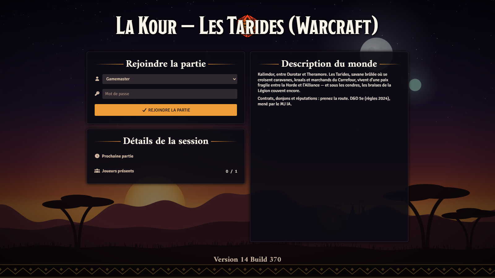
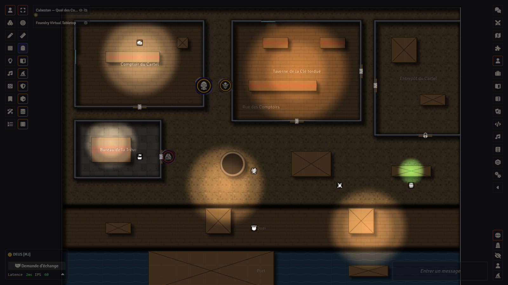
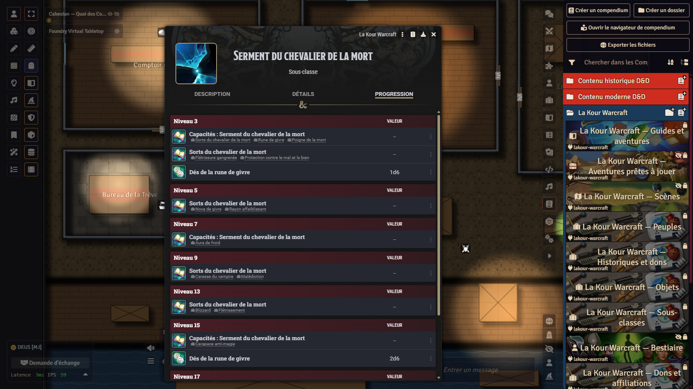
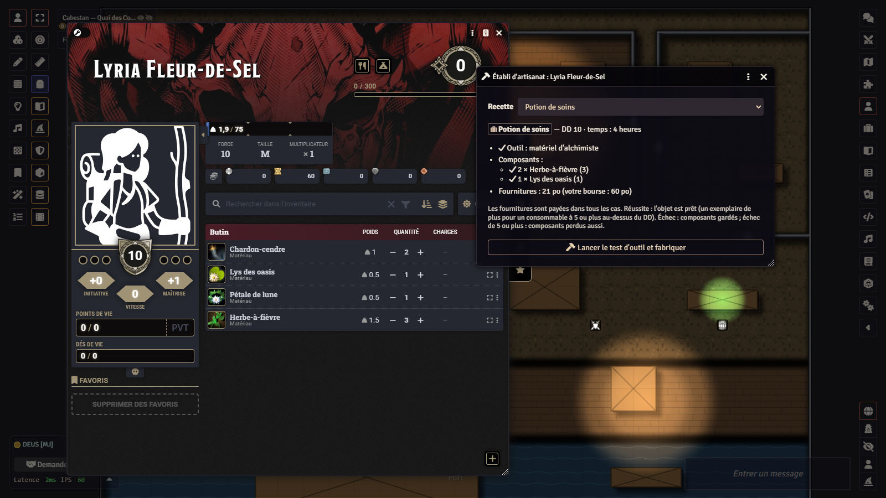

# La Kour Warcraft — Azeroth for D&D 5e in Foundry VTT

*[Version française](README.md)*

<p align="center">
  
  
  
  
</p>

**La Kour Warcraft** is a content module for [Foundry Virtual Tabletop](https://foundryvtt.com) and the
[dnd5e](https://github.com/foundryvtt/dnd5e) system (D&D fifth edition, 2024 rules) for playing in the Warcraft
universe: thirteen playable species of Azeroth, ten backgrounds, thirteen subclasses, feats, affiliations, spells,
an armory, afflictions, professions with a crafting bench, a faction garrison, reputations, contracts, mounts, a
70-stat-block bestiary, a starter adventure, a campaign, a one-shot, a dungeon and nineteen ready-to-play maps, all
importable in one click. House rules are **automated** in Foundry, and five **seasonal festivals** bring the Barrens
to life when the companion [AI GM](https://github.com/Hogun974/lakour-mj-ia) module is present.

**The content is written in French** (the module's user interface is bilingual, French and English; an English
translation of the content is being considered, see [Languages](#languages)). All texts are original. This is an
**unofficial fan work, not affiliated with Blizzard Entertainment** (see [Trademarks and licences](#trademarks-and-licences)).

## Contents

- [Who it is for](#who-it-is-for)
- [Requirements](#requirements)
- [Installation](#installation)
- [First steps](#first-steps)
- [What the module contains](#what-the-module-contains)
- [The adventures](#the-adventures)
- [House rules and automation](#house-rules-and-automation)
- [Seasonal festivals](#seasonal-festivals)
- [The AI GM, in short](#the-ai-gm-in-short)
- [Languages](#languages)
- [Tests](#tests)
- [Repository layout](#repository-layout)
- [Contributing](#contributing)
- [Credits](#credits)
- [Trademarks and licences](#trademarks-and-licences)
- [Licence](#licence)

## Who it is for

- **Game masters** who want to run D&D 5e in Azeroth without writing everything: guides, adventures, bestiary and
  maps are ready, and handouts (letters, contracts, house rules of an inn) are shown to players with one click.
- **Players** who want a tauren totem shaman, a Forsaken SI:7 spy or a gnome Kirin Tor battle mage with complete
  dnd5e sheets (traits, advancements, spells, active effects).
- **French-speaking tables** first: all content is in French.
- **No API key and no paid service** is needed to use the module. The AI GM is an optional companion which does
  require a key from a model provider.

## Requirements

| Component | Version | Note |
|---|---|---|
| Foundry Virtual Tabletop | **v14** (verified with 14.369) | A Foundry licence is needed, as for any module. Not compatible with v13. |
| `dnd5e` system | **6.0.0 or later** (built and tested with 6.0.6) | Free; provides the 2024 rules and the SRD 5.2 (classes, spells, feats, equipment). The module references them and copies nothing. |
| `lakour-mj-ia` module (AI GM) | optional | Seasonal festivals, reputation clocks, flat or relief visual style, AI game master. Everything else works without it. |

Optional modules the code can use when active (none is required): **babele** + **dnd5e_fr-FR** (and **fr-core**)
for the dnd5e SRD in French; **Sequencer** + **JB2A**, **FXMaster**, **Calendaria**, **Item Piles** and **3D Canvas**
(`levels-3d-preview`), used by the AI GM when present.

The module uses **metres** everywhere (one square = 1.5 m). Enable dnd5e's metric units in the world settings so new
characters inherit them.

## Installation

### 1. The module, by manifest (recommended)

In Foundry: **Add-on Modules › Install Module**, paste as *Manifest URL*:

```
https://github.com/Hogun974/lakour-warcraft/releases/latest/download/module.json
```

Then enable `La Kour Warcraft` (and, if you wish, `La Kour – MJ IA`) in a dnd5e world. Updates come through
Foundry's module screen.

### 2. A blank, ready-to-play world

In Foundry: **Game Worlds › Install World**, manifest URL:

```
https://github.com/Hogun974/lakour-warcraft/releases/latest/download/world.json
```

The world comes configured (dnd5e system, module enabled, metric units, login screen). You still need to install the
module (step 1): the world does not embed it.

### 3. From source (to contribute or build yourself)

The repository does not contain the compiled compendiums (`packs/`, ignored by git): they are built from the sources
in `contenu/*.mjs`. You need Node.js 22 or later (developed with Node 25) and git.

```bash
git clone --recurse-submodules https://github.com/Hogun974/lakour-warcraft.git
cd lakour-warcraft
npm install                     # @foundryvtt/foundryvtt-cli, pinned version
npm run fabriquer-warcraft      # checks the content, writes src/ then compiles packs/
npm run essais                  # optional: 177 tests, two seconds
node outils/empaqueter-module.mjs   # optional: dist/lakour-warcraft.zip and dist/module.json
```

Then copy `modules/lakour-warcraft/` (without `src/` and `contenu/`, which only serve the build tools) into your
Foundry `Data/modules/` folder, or install `dist/lakour-warcraft.zip` from the module screen.

## First steps

1. Create a **dnd5e** world (or install the blank world) and enable the module.
2. On first launch the module offers to **install the content**: the guides (player and GM), the adventures and their
   maps are imported into the world; species, backgrounds, items, bestiary and generic locations stay in the
   compendiums. The button also lives in **Settings › La Kour Warcraft › Install**; running it again after an update
   refreshes what changed without touching your notes.
3. Alternative: the **Ready-to-play adventures** compendium holds each adventure as an *Adventure* document;
   importing it places journals, maps, NPCs, items and tables in a folder of its name. When creating a dnd5e world,
   Foundry also offers *Les Puits de cendre* as a quick start.
4. Players read the **Player's guide — Azeroth** (factions, species, regions, which class for which archetype,
   professions); the GM reads the **GM's guide — Azeroth** (timeline, tone, magic, economy, languages, advice,
   professions, garrison, festivals), hidden from players.
5. For a character: drag a **species**, a **background** and a **subclass** onto the sheet; dnd5e advancements do the
   rest (traits, proficiencies, always-prepared spells, scaling dice).

## What the module contains

Twelve compendiums in the "La Kour Warcraft" folder. Figures are those of version 0.10.1.

### Species (13 species, 40 traits)

| Alliance | Horde | Neutral |
|---|---|---|
| Human, Dwarf, Gnome, Night elf, Draenei, Worgen | Orc, Troll, Tauren, Forsaken, Blood elf, Goblin | Pandaren |

Each species is a dnd5e "race" item (2024 rules): size, speed, darkvision, two to four **traits** as separate items
(Blood fury, Wild shape, Rocket jump, Cannibalism, Favour of the loa…), granted by advancement, with active effects and
activities where they fit. Balanced against the SRD 2024 species. One player token per species, in two styles (flat,
relief).

### Backgrounds and feats (10 backgrounds, 6 origin feats)

Dalaran apprentice, Goblin cartel, Mulgore hunter, Cenarion warden, Orgrimmar grunt, Initiate of the Light, Kul Tiras
sailor, Lordaeron refugee, Silvermoon ranger, Stormwind soldier. 2024 format: three abilities, two skills, a tool, an
origin feat (SRD or homebrew), languages and starting equipment.

### Subclasses (13 subclasses, 70 features)

| Class | Subclass |
|---|---|
| Barbarian | Path of the Totem Shaman |
| Cleric | Elements Domain |
| Druid | Circle of the Emerald Dream |
| Sorcerer | Aspect of the Dragonflights |
| Fighter | Orgrimmar Gladiator |
| Wizard | Kirin Tor Tradition |
| Monk | Way of the Brewmaster |
| Warlock | Pact of the Fel |
| Paladin | Oath of the Silver Hand, Oath of the Death Knight |
| Ranger | Illidari Demon Hunter, Hunter and Pet |
| Rogue | SI:7 Agent |

(Names translated here for convenience; in the module they are in French.) The classes themselves remain those of the
dnd5e system (SRD 2024). Each subclass grants its features at the right level, its always-prepared spells, its
proficiencies and scaling dice; most features are [automated](#house-rules-and-automation).

### Feats and affiliations (36 items)

5 origin feats, 10 general feats, 4 fighting styles, 3 epic boons; 8 **affiliations** (Argent Dawn, Venture Co.,
Cenarion Circle, Kirin Tor, Kor'kron Guard, Explorers' League, Knights of the Silver Hand, Sentinels), earned through
play rather than in exchange for a feat: duty, favours by rank, a modest mechanical perk, reputation; plus three faction
boons (Flight licence, Hearthstone, Herald's tabard) and three faction drawbacks (Debt to the Cartel, Fel taint,
Bounty on your head).

### Spells (19 spells, class lists)

Three cantrips and sixteen spells of levels 1 to 5 (Storm aegis, Fel wither, Dream vines, Hammer of justice, Frost
nova, Healing stream totem, Chain lightning, Polymorph: sheep, Psalm of the Light, Blizzard, Howl of terror,
Starfall, Kirin Tor portal…), with attack, save, damage and healing activities. The journal "Spell lists of Azeroth"
registers them in dnd5e class lists.

### Items (131 items)

27 faction weapons with 2024 weapon mastery, 14 armours, shields and garments, 6 ammunition types bound to their
weapons, 31 prosthetics, gadgets and magic items (Gnomish mechanical arm, Goblin rocket boots, Hearthstone, Tear of
Elune, Drums of Bloodlust, Singing crystal of Heroism…), 25 consumables, meals and potions, 22 crafting components,
6 garrison facilities. Prices, weights, rarities, attunement, charges and active effects follow dnd5e 6 forms; two-piece
sets and group buffs are handled by the automation.

### Afflictions (17)

Lingering injuries, staged diseases (Swamp fever, Plague of the Scourge, Gnomeregan sickness…) and cumulative tiers of
fel corruption. Placed on a sheet, an affliction applies its penalties and shows its icon on the token; removing it heals.

### Bestiary (70 stat blocks, CR 0 to 6)

Creatures of Azeroth (murlocs, kobolds, gnolls, harpies, centaurs, naga, raptors, kodos, whelps), servants of the
Scourge and the Legion (ghouls, skeletons, abominations, imps, felguards, an infernal), common folk, the named NPCs of
the adventures, the dungeon bosses, the rares of the Barrens, five mounts and the hunter's pet. Each sheet has a
player-facing text, a GM note (tactics), a token in its faction's colours and features with painted icons. Numeric
profiles are adapted from the SRD 5.2 (see [Credits](#credits)).

### Tables (28), journals (24), maps (19), adventures (5)

Random tables (names by species, faces, tavern rumours, road encounters, complications, finds, weather and routes,
contracts, rares, harvesting by biome, boss loot, follower missions, surprise packages); linked journals with
clickable references and ready-to-roll checks; 4 adventure maps, 4 campaign maps, 3 one-shot maps and 8 **generic
locations** (inn, orc camp, crypt, clearing, mine, harbour, elven ruins, human village) with walls, doors, lights,
ambient sounds, regions and journal pins, drawn in flat and relief styles; one *Adventure* package per adventure.

## The adventures

| Title | Format | Levels | Length | In two words |
|---|---|---|---|---|
| **Les Puits de cendre** (The Ash Wells) | starter adventure, 4 scenes | 1 → 3 | 2–3 sessions | The wells of the Barrens turn foul, fevers and rages rise, the quilboar of Ronceroc raid the caravans and each faction blames the other; the Venture Co. of Ratchet, a neutral port where the Truce forbids Horde and Alliance to fight, pays the party to find the cause. |
| **Les Braises de la Légion** (The Embers of the Legion) | campaign, 4 chapters | 3 → 6 | 6–9 sessions | Sequel: four shards of a Burning Legion forge keep its Heart asleep under a crater; a goblin foundry, sunken ruins, a peace summit and the night of the two moons, on a 24-day clock. |
| **Une nuit aux Deux Lanternes** (A Night at the Two Lanterns) | investigation and horror one-shot, 3 acts | 3 | one evening (3–4 h) | A waystation in a storm, a doctor from Theramore who is too kind, a wrongly suspected Forsaken and a graveyard of Lordaeron refugees someone means to raise. |
| **La Raffinerie de Mèche-Noire** (The Blackwick Refinery) | three-boss dungeon | 5 | one session | A copper mine bought by a rival cartel, where a chained fire elemental is pressed to distil fire oil; phased bosses, lair actions, loot and an armour set. |
| **Les Tarides vivantes** (The Living Barrens) | sandbox supplement | 1 → 6 | alongside the campaign | Contract boards in three towns, tiered reputation with ten factions, mounts and flight routes, roaming rares with guaranteed loot, consumables and group buffs. |

Parties may be Alliance, Horde or mixed: the adventures revolve around Ratchet, where the truce holds.

## House rules and automation

The module adds Azeroth rules and has Foundry apply them where possible, never relying on names (flags set on the
documents) and breaking nothing when an API is missing: an unavailable automation switches itself off, the rest goes
on. Only the active GM writes to the world.

| Rule | What Foundry does |
|---|---|
| **Auras** (Aura of purity, Aura of frost) | The effect is copied to allies within the radius and removed when they leave; enemies in the frost aura are slowed at the start of their turn; recomputed on every move, elevation and scene levels included. |
| **Hunter's pet** | "Bind the pet" ties the beast to its ranger; its HP, AC, attack and damage follow the ranger's level. Pack aspect and Bestial frenzy are copied to the pet. |
| **Elemental totems** | The placed template is the totem; allies within 3 m receive its effect; it falls at the end of the Rage, of the combat or after 10 minutes, taking its effects with it. |
| **Scourge smite**, **Champion of the Light**, **Death grip**, **Army of the dead**, **Avatar of the elements** | Targets filtered to undead and fiends; bright light on the bearer's tokens; token pulled to the knight on a failed save; ghouls imported, placed, added to combat and dismissed; use regained against a 5th-level slot. |
| **Agent's evasion**, **Rolling keg**, **Drunken sage** | Invisibility drops on attack or spell; prone on failed save; "Topple the attacker" reaction offered when a melee attack misses the monk. |
| **Fury** (Drums of Bloodlust, Crystal of Heroism) | Once per combat: refused when a target bears Fury exhaustion, which drops at the end of combat. Non-stacking effects replaced. |
| **Sets**, **boss phase 2**, **dead links** | Set bonus toggled when both pieces are worn; GM reminder at 50% HP with the phase-2 button; links a player cannot open become plain text. |
| **Crafting bench** | Window opened from the sheet: recipe, tool proficiency, inventory components, supplies paid in coin, dnd5e tool check, product added from the compendium according to the crafting rule. |
| **Reputations**, **faction garrison** | One clock per faction (ten), from Hated to Exalted, with vendor discounts (kept by the AI GM when present); six bastion facilities (dnd5e 2024 rules). |

Only **Master of disguise** (SI:7) has no automation. The module API (`game.modules.get("lakour-warcraft").api`)
exposes `installer()`, `lierFamilier(pet, ranger)`, `ouvrirEtabli(actor)` and `cheminSelonStyle()`.

## Seasonal festivals

With the AI GM active, the real calendar (or a festival forced in its settings) dresses the Barrens in five original
festivals: **the Truce of Gifts** (winter), **the Elders' Eve** (new year), **the Night of Gourds** (autumn), **the
Drums of the Long Day** (summer solstice) and **the Ratchet Masquerade** (carnival). Each brings an illustrated GM
journal, three festival contracts, two or three items, a set dressing and a narrator instruction. Without the AI GM,
the festival journals, tables and items remain usable by hand.

## The AI GM, in short

[lakour-mj-ia](https://github.com/Hogun974/lakour-mj-ia) is a companion module, developed alongside this content and
shared by several worlds: an **AI game master** (Claude or ChatGPT, with your own key, stored in your browser) which
narrates in chat, places tokens on the module's maps "near the forge", asks for rolls, plays NPCs in combat, keeps
reputation clocks, investigations and contacts, rolls on the tables, creates AI companions to fill the table and
animates the festivals. It also brings tools **without AI**: guided turn-by-turn combat, campaign notebook, flat or
relief visual style. This content module provides what it expects: extras, token indexes, map plans, festivals,
reputations.

## Languages

- **User interface** of the module (installer, crafting bench, automation messages): French and English, following
  Foundry's language.
- **Content** (compendiums, journals, maps): French. An English version of the content is being considered;
  contributions are welcome (see [Contributing](#contributing)).

## Tests

The content is **built** from JavaScript sources (`modules/lakour-warcraft/contenu/*.mjs`) by constructors that check
every key against dnd5e 6.0.6: an unknown value, an orphan reference or a distance in feet fails the build. On top,
177 Node tests (`npm run essais`, no network) check the built documents, links, icons, units, the automation (pure
logic replayed against mutated versions of the code, all of which must be caught) and the contract with the engine. An
optional test validates the documents against the Foundry v14 schemas when `FOUNDRY_V14=<folder containing common/>`
is given.

## Repository layout

```
modules/lakour-warcraft/        the Foundry module
  module.json                   manifest
  contenu/*.mjs                 content sources (source of truth; not shipped)
  src/<pack>/*.json             generated, readable, versioned documents
  packs/                        compiled compendiums (LevelDB), not in git, built by npm run fabriquer-warcraft
  scripts/                      installer, automation, crafting bench, festivals
  assets/                       tokens (SVG, two styles), map backgrounds, illustrations
  lang/fr.json, lang/en.json    user interface
  CREDITS.md                    detailed credits (icons, SRD)
modules/lakour-mj-ia/           submodule: the shared engine (AI GM, map and token tools, validator)
outils/                         build tools (compendiums, tokens) and release packaging
essais/                         Node tests
docs/                           data shapes, publication checklist, screenshots
.github/workflows/release.yml   GitHub release on every v* tag
```

## Contributing

- **Report a problem**: [repository issues](https://github.com/Hogun974/lakour-warcraft/issues), with your Foundry,
  dnd5e and module versions and what you expected.
- **Propose content or a fix**: edit the sources in `contenu/*.mjs` (never `src/` or `packs/`, which are generated),
  run `npm run fabriquer-warcraft` then `npm run essais`, and open a pull request. A new document needs a stable key,
  original text and, if automated, a test.
- **Translate**: interface strings live in `lang/`; a content translation goes through the sources.
- Engine matters (AI GM, maps, tokens) are fixed in [lakour-mj-ia](https://github.com/Hogun974/lakour-mj-ia), then
  the submodule is updated here.
- Contributions are published under the [repository licence](#licence); do not add anything taken from Blizzard's
  games, books or websites, nor from Wizards of the Coast's books.

## Credits

- **Texts**: written by the module's author; adventures, NPCs, items, spells and guides are original.
- **Token icons**: silhouettes from [game-icons.net](https://game-icons.net) (Carl Olsen, Caro Asercion,
  Cathelineau, DarkZaitzev, Delapouite, Kier Heyl, Lorc, Skoll), licensed
  [CC BY 3.0](https://creativecommons.org/licenses/by/3.0/), recoloured and composed into medallions by the
  repository's build tools; the icon-by-icon list is in
  [`modules/lakour-warcraft/CREDITS.md`](modules/lakour-warcraft/CREDITS.md).
- **Feature and item icons**: those shipped with Foundry VTT (`icons/`), used from the Foundry installation.
- **Illustrations** (login screen, seasonal festivals): images generated locally by the author with an image model
  running on their own machine, without any remote service.
- **D&D rules**: SRD classes, feats, spells and equipment are referenced in the installed dnd5e system, never
  copied. The bestiary's numeric profiles are adapted and renamed from the SRD 5.2, and the Aspect of the Dragonflights
  subclass follows the draconic bloodline progression of the SRD 5.1; the attribution required by the licence is below.
- **Engine**: [lakour-mj-ia](https://github.com/Hogun974/lakour-mj-ia), same author.

## Trademarks and licences

**Unofficial fan work, not affiliated with Blizzard Entertainment.** Warcraft, World of Warcraft, Azeroth and related
names are trademarks or registered trademarks of Blizzard Entertainment, Inc. in the U.S. and/or other countries. This
module is neither endorsed nor supported by Blizzard; it contains no text, image, sound or data extracted from
Blizzard's games or publications: the universe's places, factions and peoples are named, everything else is written or
drawn for this module. It is distributed **free of charge, for personal, non-commercial use**, as Blizzard allows
for fan creations; it must not be sold nor bundled into a paid offer.

**Dungeons & Dragons.** 5E compatible. The module relies on Foundry's dnd5e system and takes, for creature profiles
and one subclass progression, material from the SRD under Creative Commons:

> This work includes material from the System Reference Document 5.2 (“SRD 5.2”) by Wizards of the Coast LLC,
> available at https://www.dndbeyond.com/srd. The SRD 5.2 is licensed under the Creative Commons Attribution 4.0
> International License, available at https://creativecommons.org/licenses/by/4.0/legalcode.

> This work includes material taken from the System Reference Document 5.1 (“SRD 5.1”) by Wizards of the Coast LLC
> and available at https://dnd.wizards.com/resources/systems-reference-document. The SRD 5.1 is licensed under the
> Creative Commons Attribution 4.0 International License available at https://creativecommons.org/licenses/by/4.0/legalcode.

Dungeons & Dragons and D&D are trademarks of Wizards of the Coast LLC; this module is not affiliated with Wizards of
the Coast. Foundry Virtual Tabletop is a trademark of Foundry Gaming, LLC.

## Licence

> **TODO (author): choose and confirm the licences below before the first release, then add the matching `LICENSE`
> file at the repository root and in `modules/lakour-warcraft/`; the manifest's `license` field currently points to
> this section.**

- **Code** (`scripts/`, `outils/`, `essais/`, constructors in `contenu/`): [MIT](https://opensource.org/license/mit) licence.
- **Texts, game data and original images** (descriptions, adventures, journals, maps, illustrations, composed tokens):
  [CC BY-NC-SA 4.0](https://creativecommons.org/licenses/by-nc-sa/4.0/), attribution "La Kour Warcraft, Jordan
  (Hogun974)", non-commercial, share alike.

These licences cover the author's contribution only: they grant no right over Blizzard Entertainment's trademarks and
universe, nor over SRD material (covered by its own CC BY 4.0 licence), nor over game-icons.net icons (CC BY 3.0).
