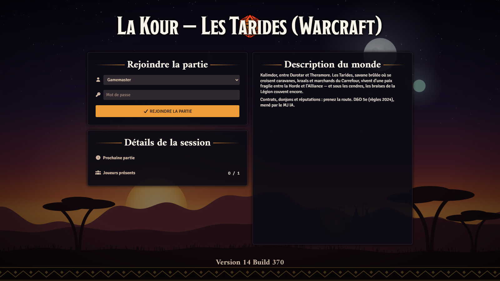
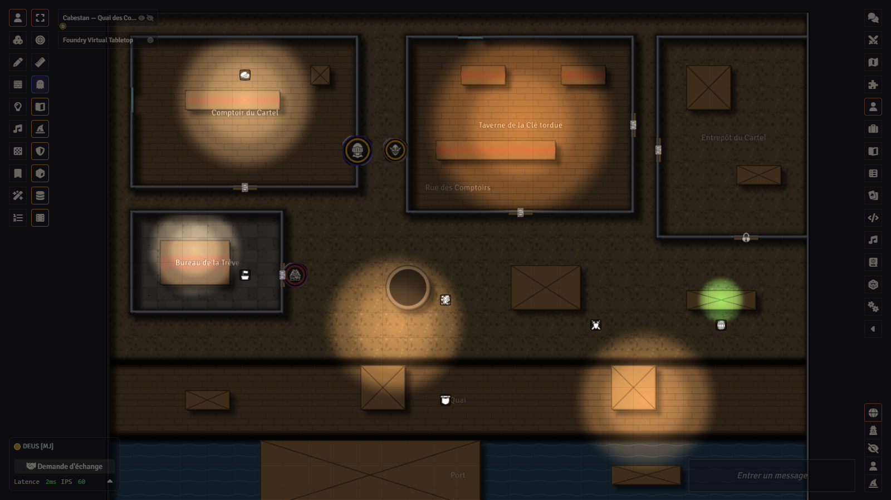
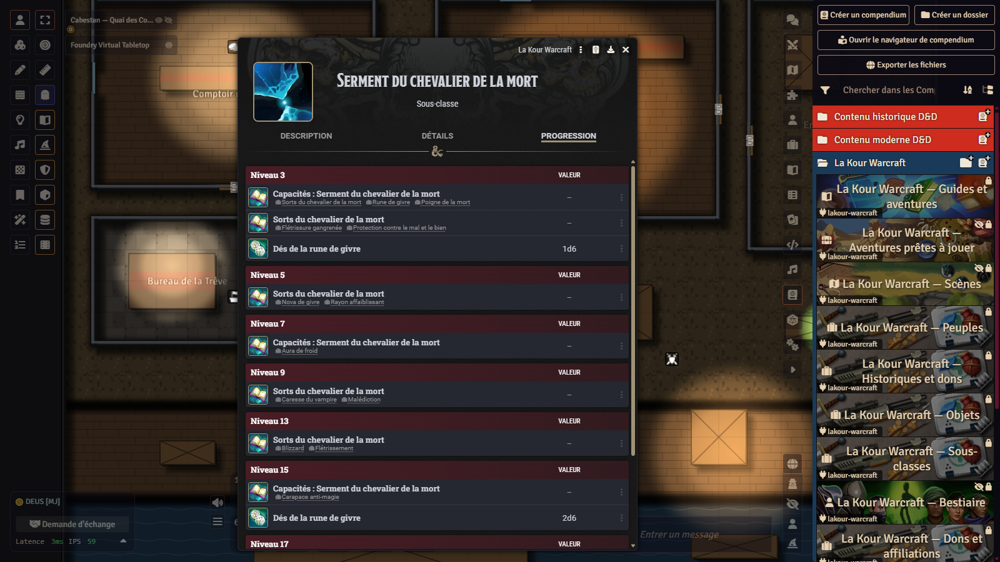
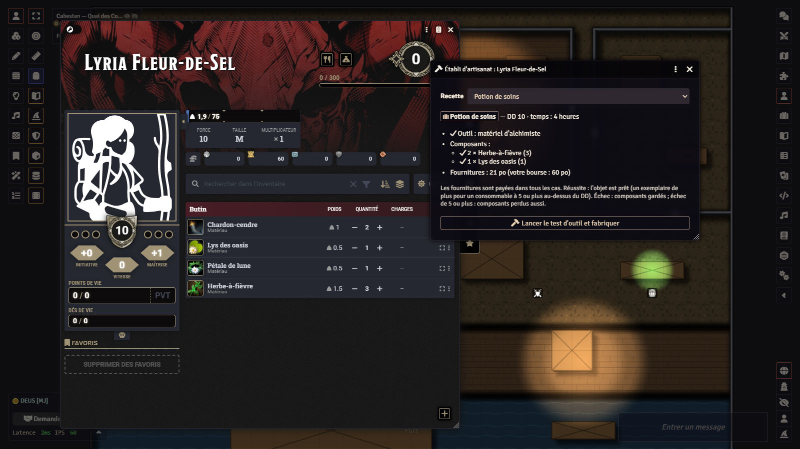

# La Kour Warcraft — Azeroth pour la 5e édition dans Foundry VTT

*[English version](README.en.md)*

<p align="center">
  
  
  
  
</p>

**La Kour Warcraft** est un module de contenu pour [Foundry Virtual Tabletop](https://foundryvtt.com) et le système
[dnd5e](https://github.com/foundryvtt/dnd5e) (D&D cinquième édition, règles 2024) qui permet de jouer dans l'univers
de Warcraft : treize peuples d'Azeroth, dix historiques, treize sous-classes, des dons, des affiliations, des sorts,
un arsenal, des afflictions, des métiers avec leur établi, une garnison de faction, des réputations, des contrats, des
montures, un bestiaire de soixante-dix fiches, une aventure de départ, une campagne, un one-shot, un donjon et dix-neuf
cartes jouables, le tout en français et importable en un clic. Les règles maison sont **automatisées** dans Foundry,
et cinq **fêtes de saison** animent les Tarides quand le module compagnon [MJ IA](https://github.com/Hogun974/lakour-mj-ia)
est présent.

Tous les textes sont originaux. C'est une **œuvre de fan non officielle, non affiliée à Blizzard Entertainment**
(voir [Marques et licences](#marques-et-licences)).

## Sommaire

- [À qui s'adresse ce module](#à-qui-sadresse-ce-module)
- [Prérequis](#prérequis)
- [Installation](#installation)
- [Premiers pas](#premiers-pas)
- [Ce que contient le module](#ce-que-contient-le-module)
- [Les aventures](#les-aventures)
- [Règles maison et automatisations](#règles-maison-et-automatisations)
- [Les fêtes de saison](#les-fêtes-de-saison)
- [Le MJ IA, en bref](#le-mj-ia-en-bref)
- [Sécurité](#sécurité)
- [Langues](#langues)
- [Essais](#essais)
- [Structure du dépôt](#structure-du-dépôt)
- [Contribuer](#contribuer)
- [Crédits](#crédits)
- [Marques et licences](#marques-et-licences)
- [Licence](#licence)

## À qui s'adresse ce module

- **Aux meneurs et meneuses de jeu** qui veulent faire jouer la 5e édition en Azeroth sans tout écrire : les guides, les
  aventures, le bestiaire et les cartes sont prêts, et les aides de jeu (lettres, contrats, règlements) se montrent
  aux joueurs d'un clic.
- **Aux joueurs et joueuses** qui veulent un tauren chaman des totems, une réprouvée espionne du SI:7 ou un gnome
  mage de bataille du Kirin Tor, avec des fiches dnd5e complètes (traits, avancements, sorts, effets actifs).
- **Aux tables francophones** d'abord : tout le contenu est en français (voir [Langues](#langues)).
- Il ne faut **aucune clé d'API ni aucun service payant** pour utiliser le module. Le MJ IA est un compagnon
  facultatif, qui lui demande une clé chez un fournisseur de modèles.

## Prérequis

| Composant | Version | Remarque |
|---|---|---|
| Foundry Virtual Tabletop | **v14** (vérifié avec la 14.369) | Licence Foundry nécessaire, comme pour tout module. Le module n'est pas compatible v13. |
| Système `dnd5e` | **6.0.0 ou plus** (développé et éprouvé avec la 6.0.6) | Gratuit ; apporte les règles 2024 et le SRD 5.2.1 (classes, sorts, dons, équipement). Le module s'y réfère sans rien recopier. |
| Module `lakour-mj-ia` (MJ IA) | facultatif | Fêtes de saison, horloges de réputation, style visuel plat ou relief, meneur de jeu IA. Sans lui, le reste du module fonctionne. |

Modules facultatifs que le code sait exploiter quand ils sont actifs (rien n'est exigé) :

- **babele** et **dnd5e_fr-FR** (plus **fr-core**) : le SRD de dnd5e en français, pour que les classes et sorts
  référencés s'affichent dans la même langue que le module ;
- **Sequencer** + **JB2A** (animations), **FXMaster** (météo), **Calendaria** (calendrier et météo du jour),
  **Item Piles** (butin, coffres, marchands), **3D Canvas** (`levels-3d-preview`, vue en relief) : utilisés par le
  MJ IA s'ils sont là.

Le module règle ses distances en **mètres** (une case = 1,5 m). Activez les unités métriques de dnd5e dans le monde
(réglages du système) pour que les personnages créés en héritent.

## Installation

### 1. Le module, par son manifeste (recommandé)

Dans Foundry : **Modules complémentaires › Installer un module**, collez dans *URL du manifeste* :

```
https://github.com/Hogun974/lakour-warcraft/releases/latest/download/module.json
```

Puis, dans un monde dnd5e, activez `La Kour Warcraft` (et, si vous le souhaitez, `La Kour – MJ IA`). Les mises à jour
se font ensuite depuis l'écran des modules de Foundry.

### 2. Un monde vierge prêt à jouer

Dans Foundry : **Mondes de jeu › Installer un monde**, URL du manifeste :

```
https://github.com/Hogun974/lakour-warcraft/releases/latest/download/world.json
```

Le monde arrive configuré (système dnd5e, module activé, unités métriques, écran d'accueil). Il faut tout de même
installer le module (étape 1) : le monde ne l'embarque pas.

### 3. Depuis les sources (pour contribuer ou fabriquer soi-même)

Le dépôt ne contient pas les compendiums compilés (`packs/`, ignorés par git) : on les fabrique à partir des sources
`contenu/*.mjs`. Il faut Node.js 22 ou plus (développé avec Node 25) et git.

```bash
git clone --recurse-submodules https://github.com/Hogun974/lakour-warcraft.git
cd lakour-warcraft
npm install                     # @foundryvtt/foundryvtt-cli, version épinglée
npm run fabriquer-warcraft      # vérifie le contenu, écrit src/ puis compile packs/
npm run essais                  # facultatif : 190 essais, deux secondes
node outils/empaqueter-module.mjs   # facultatif : dist/lakour-warcraft.zip et dist/module.json
```

Copiez ensuite `modules/lakour-warcraft/` (sans `src/` ni `contenu/`, qui ne servent qu'aux fabricants) dans le
dossier `Data/modules/` de votre Foundry, ou installez `dist/lakour-warcraft.zip` par l'écran des modules.

## Premiers pas

1. Créez un monde **dnd5e** (ou installez le monde vierge) et activez le module.
2. Au premier lancement, le module propose d'**installer le contenu** : les guides (joueur et MJ), les aventures et
   leurs cartes sont importés dans le monde ; peuples, historiques, objets, bestiaire et lieux génériques restent dans
   les compendiums. Le bouton est aussi dans **Réglages › La Kour Warcraft › Installer** ; relancer l'installation
   après une mise à jour rafraîchit ce qui a changé sans toucher à vos notes.
3. Autre voie : le compendium **Aventures prêtes à jouer** contient chaque aventure en un paquet *Adventure* ;
   l'importer pose journaux, cartes, PNJ, objets et tables dans un dossier à son nom. À la création d'un monde dnd5e,
   Foundry propose d'ailleurs *Les Puits de cendre* en démarrage rapide.
4. Les joueurs lisent le **Guide du joueur — Azeroth** (factions, peuples, régions, quelle classe pour quel archétype,
   métiers) et **Le livre des Tarides** (le livre d'univers : les lieux, les pouvoirs, les peuples en récit, la vie de
   tous les jours, les fêtes, des portraits, des rumeurs, un lexique) ; le MJ lit le **Guide du MJ — Azeroth** (chronologie, ton, magie, économie, langues, conseils, métiers,
   garnison, fêtes), caché aux joueurs.
5. Pour un personnage : glissez un **peuple**, un **historique** et une **sous-classe** sur la fiche ; les avancements
   de dnd5e font le reste (traits, maîtrises, sorts toujours préparés, dés qui évoluent).

## Ce que contient le module

Douze compendiums, rangés dans le dossier « La Kour Warcraft ». Les chiffres sont ceux de la version 0.11.0.

### Peuples (13 peuples, 40 traits)

| Alliance | Horde | Neutre |
|---|---|---|
| Humain, Nain, Gnome, Elfe de la nuit, Draeneï, Worgen | Orc, Troll, Tauren, Réprouvé, Elfe de sang, Gobelin | Pandaren |

Chaque peuple est un objet « race » de dnd5e (règles 2024) : taille, vitesse, vision dans le noir, deux à quatre
**traits** en objets à part (Fureur sanguinaire, Forme sauvage, Saut de fusée, Cannibalisme, Faveur des loa…), accordés
par avancement, avec effets actifs et activités quand ils s'y prêtent. Équilibrés sur les peuples du SRD 2024. Un
jeton de personnage par peuple, en deux styles (plat, relief).

### Historiques et dons (10 historiques, 6 dons d'origine)

Apprenti de Dalaran, Cartel gobelin, Chasseur des Mulgore, Gardien cénarien, Grunt d'Orgrimmar, Initié de la Lumière,
Marin de Kul Tiras, Réfugié de Lordaeron, Rôdeur de Lune-d'argent, Soldat de Hurlevent. Au format 2024 : trois
caractéristiques, deux compétences, un outil, un don d'origine (du SRD ou maison : Coriace, Grâce de la Lumière, Lien
sylvestre, Pied marin, Pisteur des plaines, Rempart du rang), des langues et l'équipement de départ.

### Sous-classes (13 sous-classes, 70 capacités)

| Classe | Sous-classe |
|---|---|
| Barbare | Voie du chaman des totems |
| Clerc | Domaine des Éléments |
| Druide | Cercle du Rêve d'émeraude |
| Ensorceleur | Aspect des Vols draconiques |
| Guerrier | Gladiateur d'Orgrimmar |
| Magicien | Tradition du Kirin Tor |
| Moine | Voie du maître brasseur |
| Occultiste | Pacte de la Gangrène |
| Paladin | Serment de la Main d'argent, Serment du chevalier de la mort |
| Rôdeur | Chasseur de démons illidari, Chasseur et son familier |
| Roublard | Espion du SI:7 |

Les classes elles-mêmes restent celles du système dnd5e (SRD 2024). Chaque sous-classe accorde ses capacités au bon
niveau, ses sorts toujours préparés, ses maîtrises et ses dés évolutifs ; la plupart des capacités sont
[automatisées](#règles-maison-et-automatisations).

### Dons et affiliations (36 objets)

- **Dons** : 5 dons d'origine (Bricoleur gobelin, Cuisinier de campagne, Lien avec un loa, Marchandeur du Cartel,
  Rescapé du Fléau), 10 dons généraux (Agent du SI:7, Artilleur de Forgefer, Cavalier des steppes, Hurlement de guerre
  orc, Mage de bataille du Kirin Tor…), 4 styles de combat (Brise-rangs, Gardien du totem, Sentinelle de la Muraille,
  Tireur des Pérégrins), 3 faveurs épiques.
- **Affiliations** : huit ordres (Aube d'argent, Cartel Gentepression, Cercle cénarien, Kirin Tor, Garde kor'kron,
  Ligue des explorateurs, Chevaliers de la Main d'argent, Sentinelles), accordés par le jeu et non en échange d'un
  don : devoir, faveurs par rang, avantage modeste, réputation. Plus trois atouts (Brevet de vol, Pierre de foyer,
  Tabard de héraut) et trois handicaps de faction (Dette envers le Cartel, Souillure de la gangrène, Tête mise à prix).

### Sorts (19 sorts, listes par classe)

Tours de magie (Étincelle de la Lumière, Horion élémentaire, Trait de l'ombre), niveaux 1 à 5 (Égide d'orage,
Flétrissure gangrenée, Sarments du Rêve, Marteau de justice, Nova de givre, Totem du flot guérisseur, Éclair bondissant,
Métamorphose ovine, Psaume de la Lumière, Blizzard, Hurlement de terreur, Chute d'étoiles d'Élune, Portail du Kirin
Tor…), avec activités d'attaque, de sauvegarde, de dégâts et de soins. Le journal « Listes de sorts d'Azeroth » les
inscrit dans les listes de classe de dnd5e (barde, clerc, druide, paladin, rôdeur, ensorceleur, occultiste, magicien).

### Objets (131 objets)

| Famille | Exemples |
|---|---|
| Armes de faction (27), avec botte d'arme 2024 | Glaive de Sentinelle, Hache d'Orgrimmar, Fusil à lunette de Dun Morogh, Arbalète gnome à répétition, Marteau de la Main d'argent |
| Armures, boucliers, vêtements (14) | Cuir clouté des Sentinelles, Harnois de grunt, Demi-plate en mithril de Khaz Modan, Bouclier du lion |
| Munitions liées à leurs armes (6) | Balles d'argent de Gilnéas, Carreaux explosifs gobelins, Flèches incendiaires de Quel'Thalas |
| Prothèses, bricolages et objets magiques (31) | Bras mécanique gnome, Bottes-fusées gobelines, Pierre de foyer, Larme d'Élune, Tambours de Furie sanguinaire, Cristal chantant d'Héroïsme |
| Consommables, repas et potions (25) | Bombe gobeline, Flasque d'huile de feu, Brochettes de raptor au piment, Potion de mana mineure, Élixir de la mangouste |
| Composants et matériaux de métier (22) | Minerai de fer rouge, Pétale de lune, Cuir gangrené, Éclat de cristal de mana |
| Installations de garnison (6) | Forge de garnison, Atelier gobelin, Autel des esprits, Jardin d'herboriste, Enclos à montures, Table des missions des suivants |

Prix, poids, raretés, lien (harmonisation), charges et effets actifs suivent les formes de dnd5e 6 ; les ensembles de
deux pièces et les buffs de groupe sont gérés par les automatismes.

### Afflictions (17)

Blessures persistantes (Œil crevé, Jambe boiteuse, Côtes brisées…), maladies à stades (Fièvre des marais, Peste du
Fléau, Mal de Gnomeregan, Toux noire…) et corruption gangrenée en paliers cumulatifs (Murmures gangrenés → Au seuil de
la Légion). Posée sur une fiche, une affliction applique ses malus et affiche son icône sur le jeton ; la retirer guérit.

### Bestiaire (70 fiches, FP 0 à 6)

Créatures d'Azeroth (murlocs, kobolds, gnolls, harpies, centaures, nagas, raptors, kodos, dragonnets), serviteurs du
Fléau et de la Légion (goules, squelettes, abominations, diablotins, gangregardes, infernal), gens du commun (gardes,
grunts, marchands, prêtres), les PNJ nommés des aventures, les boss du donjon, les rares des Tarides, cinq montures et
le familier du chasseur. Chaque fiche a un texte joueur, une note du MJ (tactique), un jeton aux couleurs de son camp
et des capacités aux icônes peintes. Les profils chiffrés sont adaptés du SRD 5.2.1 (voir [Crédits](#crédits)).

### Tables (28), journaux (25), cartes (19), aventures (5)

- **Tables** : noms par peuple, visages, rumeurs de taverne, rencontres sur la route, complications, trouvailles, temps
  et chemins, contrats (trois villes et cinq fêtes), rares par zone, récolte par biome, butin des boss, missions des
  suivants, paquets-surprises.
- **Journaux** : les deux guides, **Le livre des Tarides** (le livre d'univers des joueurs : seize pages, de l'arrivée
  à Cabestan au lexique, avec les lieux, les pouvoirs, les treize peuples en récit, la vie de tous les jours, la foi, les
  fêtes, des portraits et des rumeurs), les trois aventures et le donjon, les aides de jeu (lettres, contrat, règlement,
  registre, sauf-conduit, carnet), le guide de la réputation, les routes aériennes, les recettes d'artisanat, la
  garnison, le tableau des contrats, les rares, les cinq fêtes. Les journaux sont **liés** (références cliquables vers
  les fiches, jets de dés et sauvegardes prêts à lancer).
- **Cartes** : 4 pour l'aventure, 4 pour la campagne, 3 pour le one-shot et 8 **lieux génériques** (auberge, campement
  orc, crypte, clairière, mine, port, ruines elfiques, village humain) à sortir quand le récit y mène. Grille de 1,5 m,
  murs, portes, lumières, sons d'ambiance, zones (texte de lore à l'entrée, pause avant un combat) et épingles vers la
  page du journal ; fond dessiné en deux styles, plat et relief.
- **Aventures prêtes à jouer** : un paquet *Adventure* par aventure (voir ci-dessous), importable en un clic.

## Les aventures

| Titre | Format | Niveaux | Durée | En deux mots |
|---|---|---|---|---|
| **Les Puits de cendre** | aventure de départ, 4 scènes | 1 → 3 | 2 à 3 séances | Les puits des Tarides se gâtent (goût de cendre, lueur verte la nuit), les fièvres et les colères montent, les hurans de Ronceroc attaquent les caravanes et chaque faction accuse l'autre ; le Cartel Gentepression de Cabestan, port neutre où la Trêve interdit à la Horde et à l'Alliance de se battre, paie le groupe pour trouver la cause. |
| **Les Braises de la Légion** | campagne, 4 chapitres | 3 → 6 | 6 à 9 séances | Suite des Puits : quatre éclats d'une forge de la Légion ardente, les Braises, tiennent son Cœur endormi sous le cratère de Brasegouffre ; une fonderie gobeline, des ruines englouties, un sommet de négociation et la nuit des deux lunes, sur une horloge de 24 jours. |
| **Une nuit aux Deux Lanternes** | one-shot d'enquête et d'horreur, 3 actes | 3 | une soirée (3 à 4 h) | Un relais sous l'orage, un médecin de Theramore trop aimable, une réprouvée soupçonnée à tort et un cimetière de réfugiés de Lordaeron qu'on veut relever à l'heure morte. |
| **La Raffinerie de Mèche-Noire** | donjon à trois boss | 5 | une séance | Une mine de cuivre rachetée par un cartel rival, où l'on presse un élémentaire de feu enchaîné pour distiller de l'huile de feu ; boss à phases, actions de repaire, butin et ensemble d'armure. Se joue sur la carte générique « Lieu — Mine ». |
| **Les Tarides vivantes** | supplément de bac à sable | 1 → 6 | au fil de la campagne | Contrats affichés dans trois villes, réputation à paliers auprès de dix factions, montures et routes aériennes, rares et élites errants avec butin garanti, consommables et buffs de groupe. |

Les groupes peuvent être de l'Alliance, de la Horde ou mixtes : les aventures se déroulent autour de Cabestan, où la
trêve tient. Chaque aventure a son journal du MJ (synopsis, scènes avec indices chiffrés, dénouements, forces en
présence), ses aides de jeu visibles des joueurs, ses cartes épinglées et ses PNJ.

## Règles maison et automatisations

Le module ajoute des règles d'Azeroth et les fait appliquer par Foundry quand c'est possible, sans jamais se fier aux
noms (des drapeaux posés sur les documents) et sans rien casser si une API manque : un automatisme indisponible
s'éteint, le reste continue. Seul le MJ actif écrit dans le monde ; les refus avant utilisation se font sur le poste du
joueur.

| Règle | Ce que fait Foundry |
|---|---|
| **Auras** (Aura de pureté, Aura de froid) | L'effet est copié sur les alliés dans le rayon (selon le niveau) et retiré quand ils en sortent ; les ennemis de l'Aura de froid sont ralentis au début de leur tour ; recalcul à chaque déplacement, altitude et niveaux de scène compris. |
| **Familier du chasseur** | « Lier le familier » attache la bête au rôdeur ; ses points de vie, sa CA, son toucher et ses dégâts suivent le niveau du rôdeur, à chaque montée de niveau et au chargement. Aspect de la meute et Frénésie bestiale sont recopiés sur le familier. |
| **Totems élémentaires** (chaman des totems) | Le gabarit posé est le totem ; les alliés à 3 m reçoivent son effet ; il tombe à la fin de la Rage, du combat ou après 10 minutes, et emporte ses effets. Planter hors de la Rage est refusé. |
| **Châtiment du Fléau** | La sauvegarde ne vise que morts-vivants et fiélons ; les autres cibles sont filtrées, un type inconnu laisse la main au MJ. |
| **Champion de la Lumière** | Les jetons du porteur émettent une lumière vive de 9 m pendant l'effet ; la lumière d'avant est rétablie. |
| **Poigne de la mort**, **Armée des morts** (chevalier de la mort) | Sauvegarde ratée : le jeton est attiré jusqu'au chevalier (remis en place si une résistance légendaire est dépensée). Les goules sont importées, posées, ajoutées au combat, puis renvoyées à la fin. |
| **Avatar des éléments** | « Regagner l'avatar » rend l'utilisation contre un emplacement de niveau 5, avec les garde-fous de dnd5e. |
| **Évasion d'agent**, **Fût roulant**, **Ivresse du sage** | L'invisibilité tombe quand l'espion attaque ou lance un sort ; à terre sur sauvegarde ratée ; réaction « Renverser l'assaillant » proposée quand une attaque au corps à corps rate le moine. |
| **Fureur** (Tambours de Furie sanguinaire, Cristal d'Héroïsme) | Une fois par combat : refus si une cible porte l'Épuisement de la fureur, qui tombe à la fin du combat. Effets non cumulables remplacés. |
| **Ensembles** (Tenue réglementaire de Mèche-Noire) | Le bonus s'allume quand les deux pièces sont équipées, s'éteint sinon. |
| **Phase 2 des boss** | À 50 % des points de vie, rappel chuchoté au MJ avec le bouton de la capacité de phase 2. |
| **Établi d'artisanat** | Fenêtre ouverte depuis la fiche : recette, maîtrise de l'outil, composants de l'inventaire, fournitures payées en pièces, test d'outil de dnd5e, produit du compendium ajouté à l'inventaire selon la règle d'artisanat (composants gardés sur un échec, perdus sur un échec de 5 ou plus). |
| **Réputations** | Une horloge par faction (dix), de Haï à Exalté, avec remises chez l'intendant ; tenue par le MJ IA quand il est là. |
| **Garnison de faction** | Six installations de bastion (règles 2024 de dnd5e : ordres, tours de bastion) thématisées Horde, Alliance et Cartel ; activez le réglage « Bastions » du système. |
| **Liens morts** | Dans le chat d'un joueur, un lien vers un compendium qu'il ne peut pas ouvrir (bestiaire, scènes) devient du texte simple. |

Ce qui reste à l'appréciation du MJ est dit dans le texte de la capacité ; à ce jour, seul **Maître du déguisement**
(SI:7) n'a aucune automatisation. L'API du module (`game.modules.get("lakour-warcraft").api`) expose `installer()`,
`lierFamilier(familier, rodeur)`, `ouvrirEtabli(acteur)` et `cheminSelonStyle()`.

## Les fêtes de saison

Avec le MJ IA actif, le calendrier réel (ou une fête forcée dans ses réglages) habille les Tarides de cinq fêtes
originales : **la Trêve des Présents** (hiver), **la Veille des Aïeux** (nouvel an), **la Nuit des Calebasses**
(automne), **les Tambours du Long Jour** (solstice d'été) et **la Mascarade de Cabestan** (carnaval). Chacune apporte
un journal du MJ illustré (ambiance au Carrefour, à Theramore, à Cabestan et dans les kraals, accroches), trois contrats
de fête, deux ou trois objets (Grelot de l'Épineux, Lampe-étoile des aïeux, Calebasse-lanterne, Fusée gobeline du Long
Jour, Masque de la Mascarade…), un décor et une consigne au narrateur. Sans le MJ IA, les journaux, tables et objets
des fêtes restent utilisables à la main.

## Le MJ IA, en bref

[lakour-mj-ia](https://github.com/Hogun974/lakour-mj-ia) est un module compagnon, développé avec ce contenu et
commun à plusieurs mondes : un **meneur de jeu IA** (Claude ou ChatGPT, avec votre propre clé, stockée dans votre
navigateur) qui raconte dans le chat, pose les jetons sur les cartes du module « près de la forge », demande les jets,
joue les PNJ en combat, tient les horloges de réputation, les enquêtes et les contacts, tire dans les tables, crée des
compagnons IA pour compléter la table et anime les fêtes. Il apporte aussi des outils **sans IA** : tour par tour
guidé, carnet de campagne, style visuel plat ou relief. Son guide d'utilisation est installé dans chaque monde et lisible
dans son dépôt. Ce module de contenu lui fournit ce qu'il attend : figurants, index des jetons, plans des cartes,
fêtes, réputations.

## Sécurité

- **Clé d'API** : le moteur du MJ IA (`lakour-mj-ia`) garde votre clé Claude ou ChatGPT dans le navigateur du MJ
  (réglage de portée « client », stockage local), jamais sur le serveur ni chez les joueurs ; les appels à l'IA partent
  de ce navigateur. Tout script qui tourne dans cette page (un autre module installé, par exemple) peut donc la lire :
  n'installez que des modules de confiance, ne jouez pas le MJ depuis un poste partagé, et fixez un plafond de dépense
  à la clé chez le fournisseur.
- **MJ-assistant** : pour Foundry, un MJ-assistant est un MJ. Il voit tout ce que voit le MJ (journaux et tables
  secrets, PNJ, cartes privées des automatismes et leurs boutons). Ne donnez ce rôle qu'à quelqu'un qui pourrait mener
  la partie.
- **Monde vierge** : l'utilisateur « Gamemaster » du monde prêt à jouer n'a pas de mot de passe. Donnez-lui-en un
  (**Configuration** › **Utilisateurs**) avant d'inviter qui que ce soit, sinon le premier venu entre en MJ.

## Langues

- **Interface** du module (installateur, établi, messages des automatismes) : français et anglais, selon la langue de
  Foundry.
- **Contenu** (compendiums, journaux, cartes) : français. Une version anglaise du contenu est envisagée ; les
  contributions sont bienvenues (voir [Contribuer](#contribuer)).

## Essais

Le contenu est **fabriqué** à partir de sources JavaScript (`modules/lakour-warcraft/contenu/*.mjs`) par des
constructeurs qui vérifient chaque clé contre le système dnd5e 6.0.6 : une valeur inconnue, une référence orpheline ou
une distance en pieds font échouer la fabrication. Par-dessus, 190 essais Node (`npm run essais`, aucun réseau) vérifient
les documents fabriqués, les liens, les icônes, les unités, les automatismes (logique pure rejouée sur des versions
mutées du code, qui doivent toutes être repérées) et le contrat passé avec le moteur. Un essai facultatif valide les
documents contre les schémas de Foundry v14 quand `FOUNDRY_V14=<dossier contenant common/>` est fourni.

```bash
npm run essais       # essais de ce dépôt
npm run contrat      # ce que le MJ IA attend d'un module de contenu
npm run valider -- <dossier de Foundry v14>   # schémas Foundry, 0 erreur attendue
```

## Structure du dépôt

```
modules/lakour-warcraft/        le module Foundry
  module.json                   manifeste
  contenu/*.mjs                 sources du contenu (source de vérité ; pas livrées)
  src/<pack>/*.json             documents générés, lisibles, versionnés (diff utile)
  packs/                        compendiums compilés (LevelDB), hors git, fabriqués par npm run fabriquer-warcraft
  scripts/                      installateur, automatismes, établi, fêtes
  assets/                       jetons (SVG, deux styles), fonds de cartes, illustrations
  lang/fr.json, lang/en.json    interface
  CREDITS.md                    crédits détaillés (icônes, SRD)
modules/lakour-mj-ia/           sous-module : le moteur commun (MJ IA, outils de cartes et de jetons, validateur)
outils/                         fabricants (compendiums, jetons) et empaquetage pour release
essais/                         essais Node
docs/                           formes des données (contenu-warcraft.md), publication, captures
.github/workflows/release.yml   release GitHub à chaque tag v*
```

## Contribuer

- **Signaler un problème** : [issues du dépôt](https://github.com/Hogun974/lakour-warcraft/issues), avec la version
  de Foundry, de dnd5e et du module, et ce qui était attendu.
- **Proposer du contenu ou un correctif** : modifiez les sources `contenu/*.mjs` (jamais `src/` ni `packs/`, qui sont
  générés), lancez `npm run fabriquer-warcraft` puis `npm run essais`, et ouvrez une pull request. Un nouveau document
  a besoin d'une clé stable, d'un texte original et, s'il s'automatise, d'un essai.
- **Traduire** : les chaînes d'interface sont dans `lang/` ; une traduction du contenu passe par les sources.
- Ce qui relève du moteur (MJ IA, cartes, jetons) se corrige dans [lakour-mj-ia](https://github.com/Hogun974/lakour-mj-ia),
  puis le sous-module est mis à jour ici (`git submodule update --remote modules/lakour-mj-ia`).
- Toute contribution est publiée sous la [licence du dépôt](#licence) ; n'y versez rien qui vienne des jeux, des
  livres ou des sites de Blizzard ni des livres de Wizards of the Coast.

## Crédits

- **Textes** : écrits par l'auteur du module ; les aventures, PNJ, objets, sorts et guides sont originaux.
- **Icônes des jetons** : silhouettes de [game-icons.net](https://game-icons.net) (Carl Olsen, Caro Asercion,
  Cathelineau, DarkZaitzev, Delapouite, Kier Heyl, Lorc, Skoll), licence
  [CC BY 3.0](https://creativecommons.org/licenses/by/3.0/), recolorées et composées en médaillon par les fabricants du
  dépôt ; la liste icône par icône est dans [`modules/lakour-warcraft/CREDITS.md`](modules/lakour-warcraft/CREDITS.md).
- **Icônes des capacités et des objets** : celles livrées avec Foundry VTT (`icons/`), utilisées depuis
  l'installation de Foundry.
- **Illustrations** (écran d'accueil, fêtes de saison) : images générées localement par l'auteur avec un modèle
  d'image exécuté sur sa machine, sans service distant.
- **Règles de D&D** : les classes, dons, sorts et équipements du SRD sont référencés dans le système dnd5e installé,
  jamais recopiés. Les profils chiffrés des créatures du bestiaire sont adaptés et renommés à partir du SRD 5.2.1, et la
  progression de la sous-classe Aspect des Vols draconiques suit la lignée draconique du SRD 5.1 ; l'attribution
  exigée par la licence figure ci-dessous.
- **Moteur** : [lakour-mj-ia](https://github.com/Hogun974/lakour-mj-ia), même auteur.

## Marques et licences

**Œuvre de fan non officielle, non affiliée à Blizzard Entertainment.** Warcraft, World of Warcraft, Azeroth et les
noms associés sont des marques ou des marques déposées de Blizzard Entertainment, Inc. aux États-Unis et dans d'autres
pays. Ce module n'est ni approuvé ni soutenu par Blizzard ; il ne contient aucun texte, image, son ni donnée extraits
des jeux ou des publications de Blizzard : les lieux, factions et peuples de l'univers y sont nommés, tout le reste est
écrit ou dessiné pour ce module. Il est distribué **gratuitement, pour un usage personnel et non commercial**,
conformément à ce que Blizzard permet aux créations de fans ; il ne doit être ni vendu ni intégré à une offre payante.

**Dungeons & Dragons.** Compatible avec la cinquième édition (« 5E compatible »). Le module s'appuie sur le système
dnd5e de Foundry et reprend, pour les profils de créatures et une progression de sous-classe, du matériel du SRD sous
licence Creative Commons :

> This work includes material from the System Reference Document 5.2.1 (“SRD 5.2.1”) by Wizards of the Coast LLC,
> available at https://www.dndbeyond.com/srd. The SRD 5.2.1 is licensed under the Creative Commons Attribution 4.0
> International License, available at https://creativecommons.org/licenses/by/4.0/legalcode.

> This work includes material taken from the System Reference Document 5.1 (“SRD 5.1”) by Wizards of the Coast LLC
> and available at https://dnd.wizards.com/resources/systems-reference-document. The SRD 5.1 is licensed under the
> Creative Commons Attribution 4.0 International License available at https://creativecommons.org/licenses/by/4.0/legalcode.

Dungeons & Dragons et D&D sont des marques de Wizards of the Coast LLC ; ce module n'est pas affilié à Wizards of the
Coast. Foundry Virtual Tabletop est une marque de Foundry Gaming, LLC.

## Licence

- **Code** (`modules/lakour-warcraft/scripts/`, `templates/`, `lang/`, `outils/`, `essais/`, `docs/`) : licence
  **MIT**, voir [`LICENSE`](LICENSE) (© 2026 Hogun974).
- **Textes, données de jeu et images originaux** (`contenu/` et ses dictionnaires anglais, compendiums `src/` et
  `packs/`, module anglais `lakour-warcraft-en`, monde vierge `monde/`, illustrations, cartes et jetons composés de
  `assets/`) : licence [**CC BY-NC-SA 4.0**](https://creativecommons.org/licenses/by-nc-sa/4.0/deed.fr) (attribution,
  pas d'usage commercial, partage dans les mêmes conditions). Attribution attendue : « LaKour — Hogun974 », avec le
  lien vers ce dépôt et vers la licence.

Le détail, dossier par dossier, et les mentions des tiers sont dans [`LICENCE-CONTENU.md`](LICENCE-CONTENU.md) ; les
deux fichiers sont livrés dans les archives du module et du monde.

**Œuvre de fan non officielle**, ni affiliée à Blizzard Entertainment ni approuvée par elle, ni affiliée à Wizards of
the Coast : Warcraft et les noms de son univers restent à Blizzard Entertainment, Dungeons & Dragons à Wizards of the
Coast (voir « Marques et licences »). La licence CC ne couvre que les textes et images originaux de ce projet, **pas la
propriété intellectuelle de tiers** ni le matériel du SRD (SRD 5.2.1 et SRD 5.1, qui restent sous CC BY 4.0 avec leurs
mentions), et **aucun usage commercial** n'est permis. Les silhouettes des jetons sont des icônes de game-icons.net sous
**CC BY 3.0** (crédits dans `CREDITS.md`). Foundry VTT est une marque de Foundry Gaming, LLC ; ce projet n'y est pas
affilié.
