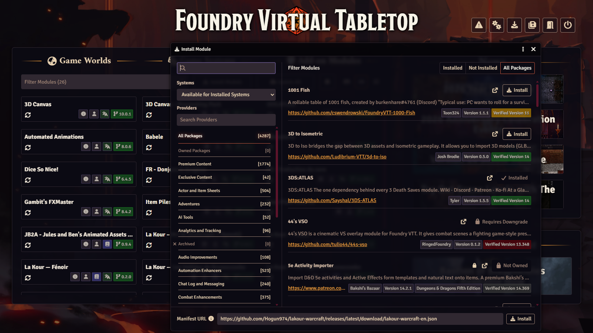
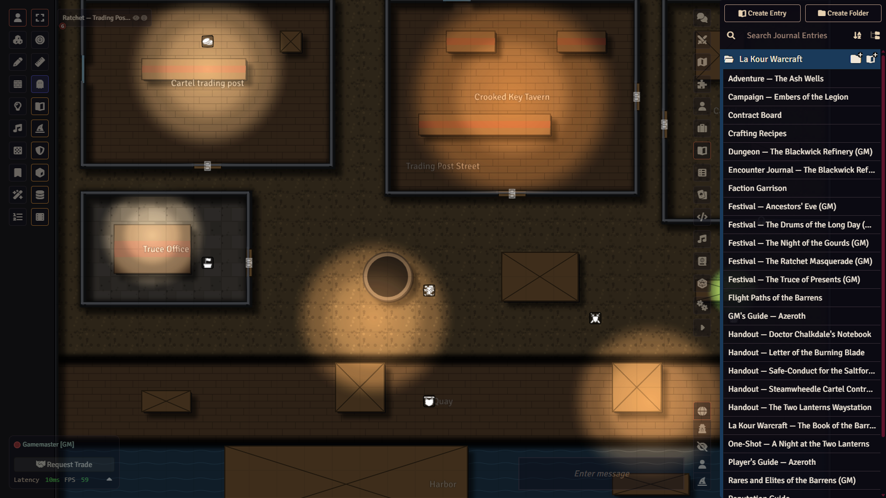
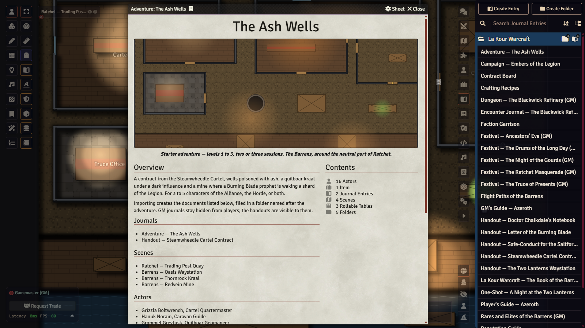
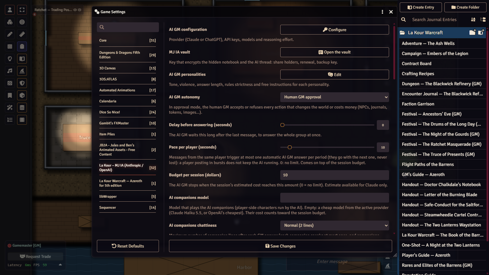

# Tutorial — La Kour Warcraft, from zero to your first session

*[Version française](TUTORIEL.md) · [README](README.en.md)*

This tutorial assumes you have never installed La Kour Warcraft. By the end you will have a Foundry world ready to play,
the starter adventure open and, if you wish, the AI game master set up with cautious settings. Allow half an hour,
downloads included.

> The screenshots referenced below (`docs/captures/tuto-…-en.png`) are taken with Foundry's interface in English; they
> may be missing until they have been added to the repository (list in
> [`docs/captures/LISEZ-MOI.md`](docs/captures/LISEZ-MOI.md)).

## Contents

1. [What you need](#1-what-you-need)
2. [Install the module](#2-install-the-module)
3. [Install the blank world](#3-install-the-blank-world)
4. [English or French edition](#4-english-or-french-edition)
5. [First launch](#5-first-launch)
6. [What the module contains](#6-what-the-module-contains)
7. [The AI GM (optional)](#7-the-ai-gm-optional)
8. [Automated house rules](#8-automated-house-rules)
9. [Your first session](#9-your-first-session)
10. [Troubleshooting](#10-troubleshooting)

## 1. What you need

| What | Version | Note |
|---|---|---|
| **Foundry Virtual Tabletop** | **v14** (tested with 14.370; manifest verified with 14.369) | A Foundry licence is required. The module does not work on v13. |
| **`dnd5e` system** | **6.0.6** recommended | The module accepts 6.0.0 and later; the blank world requires **6.0.6 or later**. Free, installed from Foundry (**Game Systems › Install System**, search for "Dungeons & Dragons Fifth Edition"). |
| **Module `lakour-warcraft-en`** (English) or `lakour-warcraft` (French) | latest | The content: species, subclasses, items, bestiary, adventures, maps. |
| **Module `lakour-mj-ia`** (La Kour – MJ IA, the AI GM) | **0.44.1** or later | **Optional** for the module alone, **required** by the blank world (install it first, section 3). Seasonal festivals, reputation clocks, flat or relief visual style, and the AI game master once configured. |

**Optional modules** the blank world enables when present and the AI GM can use: Sequencer and JB2A (animations),
Automated Animations, FXMaster (weather), Calendaria (date and daily weather), Item Piles (loot, chests, merchants),
Dice So Nice, 3D Canvas (`levels-3d-preview`, relief view). None is needed. The French translation modules (fr-core,
dnd5e_fr-FR, babele) are only useful with the French edition; the English world disables them.

## 2. Install the module

On Foundry's setup screen (where you pick a world): **Add-on Modules** tab › **Install Module**. At the bottom of the
window, paste into **Manifest URL**:

```
https://github.com/Hogun974/lakour-warcraft/releases/latest/download/lakour-warcraft-en.json
```

then **Install**. Do the same for the AI GM engine (required by the blank world, optional otherwise):

```
https://github.com/Hogun974/lakour-mj-ia/releases/latest/download/module.json
```



Updates then come through the **Update** button of the module screen: the manifest always points to the latest release.

## 3. Install the blank world

The blank world is a Foundry world that is already set up: dnd5e system, module enabled, metric units, login screen,
guides and starter-adventure maps already imported, first map active. It is published with every release, next to the
module, as an archive: `la-kour-warcraft-en.zip` (English) and `la-kour-warcraft.zip` (French).

> **Foundry 14 no longer installs a world from its manifest URL**: the **Game Worlds** tab only offers
> **Create World**. Two paths work: unzip the blank world (A) or create your own (B).

### Path A — the ready-to-play blank world

1. **First install what it requires**, by manifest URL: the **dnd5e** system 6.0.6 or later
   (**Game Systems › Install System**), then the modules `lakour-warcraft-en` and `lakour-mj-ia` (section 2).
2. **Download** `la-kour-warcraft-en.zip` from the latest release:
   <https://github.com/Hogun974/lakour-warcraft/releases/latest> (*Assets* section).
3. **Find Foundry's data folder**: setup screen › **Configuration** tab › **User Data Path** field. On a hosting
   service, use its file manager.
4. **Unzip** the archive into a new folder `Data/worlds/la-kour-warcraft-en/` (the folder name is the world's id):
   `world.json` must sit directly inside it, not in a subfolder.
5. **Restart Foundry** (the server or the application): it only sees a new world folder at startup. The world
   *La Kour — The Barrens (Warcraft, English)* then appears in **Game Worlds**.

### Path B — your own world

1. **Game Worlds › Create World**, system **Dungeons & Dragons Fifth Edition**.
2. Launch it, then **Settings › Manage Modules**: tick **La Kour Warcraft** (and **La Kour – MJ IA** if you want it).
3. On loading, the module offers to **install the content**: accept (details in section 5).

### Secure the world before inviting anyone

The blank world's **Gamemaster** user has **no password**. Launch the world, log in as Gamemaster, then
**Settings › Configuration › Users** (or from the world's login screen): give it a password. Create one user per
player there as well, with the **Player** role.

## 4. English or French edition

The content is written in French; the English edition, module **`lakour-warcraft-en`**, is built from the same sources
(same documents, same identifiers; any text not yet translated appears in French). Each edition has its own blank world.

| Edition | Module manifest | Blank world (archive from the [latest release](https://github.com/Hogun974/lakour-warcraft/releases/latest), path A of section 3) |
|---|---|---|
| English | `https://github.com/Hogun974/lakour-warcraft/releases/latest/download/lakour-warcraft-en.json` | `la-kour-warcraft-en.zip` → `Data/worlds/la-kour-warcraft-en/` |
| French | `https://github.com/Hogun974/lakour-warcraft/releases/latest/download/module.json` | `la-kour-warcraft.zip` → `Data/worlds/la-kour-warcraft/` |

**Never** enable `lakour-warcraft` and `lakour-warcraft-en` in the same world. The French tutorial is
[TUTORIEL.md](TUTORIEL.md).

## 5. First launch

1. **Launch the world** and join as Gamemaster. The login screen shows the Barrens at dusk (a programmatically drawn
   image, `assets/monde/fond.jpg`).
2. **Blank world**: the **Ratchet — Trading Post Quay** map is already active; the guides, the starter adventure, the
   campaign, the one-shot, the dungeon and the festival journals are in the **La Kour Warcraft** folder of the Journal
   tab. Nothing else to do.
3. **Your own world**: on opening, the module asks whether to **install the content**. Accept: the guides (player and
   GM), the adventures and their maps are imported; species, backgrounds, items, bestiary and generic locations stay in
   the compendiums. The same button lives in **Settings › Configure Settings › La Kour Warcraft › Install**; running it
   again after an update refreshes what changed without touching your notes. Also enable the dnd5e system's **metric
   units** (the module counts in metres, one square = 1.5 m).



4. **Read the guides**: players read the *Player's Guide — Azeroth* and *The Book of the Barrens* (the setting book);
   you read the *GM's Guide — Azeroth* (hidden from players), then the starter adventure's journal.
5. **Create the characters**: a new *Character* actor, then drag from the compendiums a **species**, a **background**,
   a dnd5e class and, at the right level, an Azeroth **subclass**. dnd5e advancements do the rest (traits,
   proficiencies, always-prepared spells). One token per species is provided, in two styles.

## 6. What the module contains

Twelve compendiums in the **La Kour Warcraft (English)** folder of the Compendiums tab:

- **Species** (13), **Backgrounds and feats**, **Subclasses** (13), **Feats and affiliations**, **Spells**, **Items**
  (weapons, armour, consumables, professions, garrison), **Afflictions**, **Bestiary** (70 stat blocks), **Tables**;
- **Guides and adventures**: the guides, the setting book, adventure and festival journals, handouts;
- **Scenes**: ready-to-play maps (walls, doors, lights, sounds, journal pins) and eight **generic locations** (inn,
  orc camp, crypt, glade, mine, port, elven ruins, village) to bring out when the story leads there;
- **Ready-to-play adventures**: each adventure as a single *Adventure* document.

| Adventure | Format | Levels |
|---|---|---|
| **The Ash Wells** | starter adventure, 4 scenes | 1 → 3 |
| **Embers of the Legion** | campaign in 4 chapters | 3 → 6 |
| **A Night at the Two Lanterns** | investigation one-shot | 3 |
| **The Blackwick Refinery** | three-boss dungeon | 5 |
| **The Living Barrens** | sandbox supplement (contracts, reputations, mounts, rares) | 1 → 6 |

**One-click import**: open the **Ready-to-play adventures** compendium, open an adventure and click **Import**;
journals, maps, NPCs, items and tables arrive in a folder of its name. When creating a dnd5e world, Foundry also offers
the starter adventure as a quick start.



## 7. The AI GM (optional)

The **La Kour – MJ IA** module (`lakour-mj-ia`) is a companion: without it, all the content remains usable by hand.
Without an API key it already brings tools (seasonal festivals, reputation clocks, guided turn-by-turn, campaign
notebook, flat or relief visual style). With **your own key** from a model provider (Anthropic's Claude or OpenAI's
ChatGPT, paid per use to that provider), it becomes an **AI game master**: it narrates in the chat, plays NPCs, places
tokens, asks for rolls, keeps reputations and runs the festivals, under the human GM's control.

The blank world ships with **cautious settings**:

| AI GM setting | Blank world value | Why |
|---|---|---|
| Active personality | **Le Conteur épique** (the epic storyteller; personality names are in French) | Warm, lively narration, faithful to the rules. |
| AI GM autonomy | **Human GM approval** | Every action that changes the world or costs money waits for your approval. |
| Budget per session | **$10** | The AI GM stops when the session's estimated cost reaches this amount. |



The key, the choice of provider, the console (wizard hat in the left toolbar), personalities, voice and security are
explained in the engine's tutorial:
**[lakour-mj-ia TUTORIAL.md](https://github.com/Hogun974/lakour-mj-ia/blob/principale/TUTORIAL.md)**
([français](https://github.com/Hogun974/lakour-mj-ia/blob/principale/TUTORIEL.md)). The engine also installs its user
guide in every world (journals *MJ IA — GM's Guide* and *MJ IA — Players' Guide*).

Two precautions: set a **spending cap** on the key at the provider (the module's budget is only an estimate), and do
not run the AI GM from a shared computer (the key is kept in the GM's browser). The AI GM narrates in the world's
language (English with `lakour-warcraft-en`); its internal prompts stay in French.

### Players' cameras

If you play with Foundry's built-in audio and video (A/V), open the AI GM console (wizard hat): its **Players'
cameras** block says whether they are allowed or cut.

1. The world is audio only? **Add video** switches it to "Audio & Video" (the relay server is kept); everyone reloads
   the page when Foundry offers it, then picks a camera in *Configure Audio/Video › Client*.
2. Some players are listed under "No camera permission"? **Give players the camera** grants the "Broadcast Video"
   permission to the Player role.
3. **Cut the cameras** and **Allow the cameras** toggle the *Players' cameras allowed* setting (also in *Settings › MJ
   IA*, checked by default). Once cut, no player's camera is shown to anyone, even if a player switches theirs back on
   from their browser console; yours stays, and **microphones are left alone**.

### AI companions, cost and autopilot

- **Companions model**: *Settings › MJ IA › AI companions model* is a list. *Default* (empty) takes a cheap model from
  the active provider (Claude Haiku 5.5, or OpenAI's cheapest); a model from the other provider falls back to that
  default.
- **Cost**: the console shows the current session's estimated cost (narrator, companions, voice, transcription)
  against the budget; reopen it to see it up to date. Once the budget is reached, the narrator stops and warns you, and
  the companions go on in simple mode, without AI.
- **Autopilot**: when no connected player has their character's token on the active scene and AI companions are
  there, the AI GM can carry on alone. It needs *Autonomous* autonomy: in approval mode, the blank world's, you only get
  a notice. The autopilot hands control back when a player returns, stops at the budget or after 60 steps (adjustable),
  and the console stops or restarts it.

These four features in detail: [README, "What engine 0.44.1 brings to the table"](README.en.md#what-engine-0441-brings-to-the-table).

## 8. Automated house rules

The module applies its Azeroth rules in Foundry where possible; only the **connected GM** writes to the world, and an
automation that cannot work switches itself off without breaking anything.

- **Auras** (Aura of Purity, Aura of Cold): the effect follows allies within range, on every move.
- **Hunter's companion**: "Bind the companion", then its hit points, AC and damage follow the ranger.
- **Elemental totems** of the totem shaman: the placed template is the totem, allies within 3 m receive its effect.
- **Death knight**: Death Grip pulls the target, Army of the Dead places and dismisses the ghouls.
- **Scourge Smite**, **Champion of the Light**, **Avatar of the Elements**, **Agent's Escape**, **Rolling Keg**,
  **Drunken Wisdom**: targeting, light, recharge and reactions handled.
- **Fury** (once per combat), item **sets**, **boss phase 2** (reminder to the GM at 50% HP).
- **Crafting bench** (button in the sheet header), **reputations** (one clock per faction, with the AI GM),
  **faction garrison** (enable dnd5e's *Bastions* setting).

Details are in the [README](README.en.md#house-rules-and-automation).

## 9. Your first session

- [ ] Gamemaster password set, one user per player created.
- [ ] Characters created (species, background, class) and their tokens placed on **Ratchet — Trading Post Quay**.
- [ ] **The Ash Wells** journal read (synopsis, scene 1, clues); handouts ready to show (*Show Players* in the
      journal header).
- [ ] Metric units enabled (dnd5e system settings).
- [ ] Optional: AI GM configured (key, personality, approval mode) and tried with a short narration.
- [ ] Start the session: Ratchet's Truce, the wells going bad, and the Cartel paying to find out why.

## 10. Troubleshooting

| Symptom | Likely cause | What to do |
|---|---|---|
| The world will not launch, "incompatible system" | dnd5e older than 6.0.6 | Update the dnd5e system (**Game Systems › Update**). |
| The blank world does not appear in **Game Worlds** | Foundry not restarted, or archive unzipped in the wrong place | Check that `Data/worlds/la-kour-warcraft-en/world.json` exists (no extra subfolder), then restart Foundry. |
| Foundry reports missing modules when launching the world | dependencies not installed | Install dnd5e, `lakour-warcraft-en` and `lakour-mj-ia` from their manifest URLs (section 2), then retry. |
| The module does not show in **Manage Modules** | Foundry v13 or older | The module requires Foundry v14. |
| Journals or maps missing in your own world | content not installed yet | **Settings › Configure Settings › La Kour Warcraft › Install**. |
| Duplicate texts, or French and English mixed | `lakour-warcraft` and `lakour-warcraft-en` both enabled | Keep only one. |
| Some texts are in French | not translated yet in the English edition | Expected; contributions welcome (see the README). |
| Distances shown in feet | the system's imperial units | Enable metric units in the dnd5e settings. |
| No toolbar and no AI GM console | no active scene | Activate a scene (right-click the map › *Activate*). |
| An aura, totem or companion does not react | no GM connected, or automation off for lack of an API | A GM must be connected; the feature's text says what stays manual. |
| The AI GM does not answer | no key, budget reached, or an approval pending | Check the AI GM console and the [engine tutorial](https://github.com/Hogun974/lakour-mj-ia/blob/principale/TUTORIAL.md). |
| Players' cameras are not shown | world in audio only, cameras cut by the setting, or players without the "Broadcast Video" permission | AI GM console, **Players' cameras** block: *Add video*, *Allow the cameras* or *Give players the camera* (section 7). |
| The autopilot does not start | autonomy set to approval, autopilot setting unchecked, or a connected player still has a visible token on the active scene | Set autonomy to *Autonomous*; an offline player does not count (section 7). |
| Festival images or the login background are missing | old module or incomplete install | Update the module (the images are in `assets/`). |

Another problem? Open an [issue](https://github.com/Hogun974/lakour-warcraft/issues) with your Foundry, dnd5e and
module versions and what you expected.

---

*La Kour Warcraft is an unofficial fan work, not affiliated with Blizzard Entertainment. Code and texts written with
the help of an AI (Anthropic's Claude), reviewed by the author; images produced programmatically. Licences:
[README](README.en.md#licence).*
