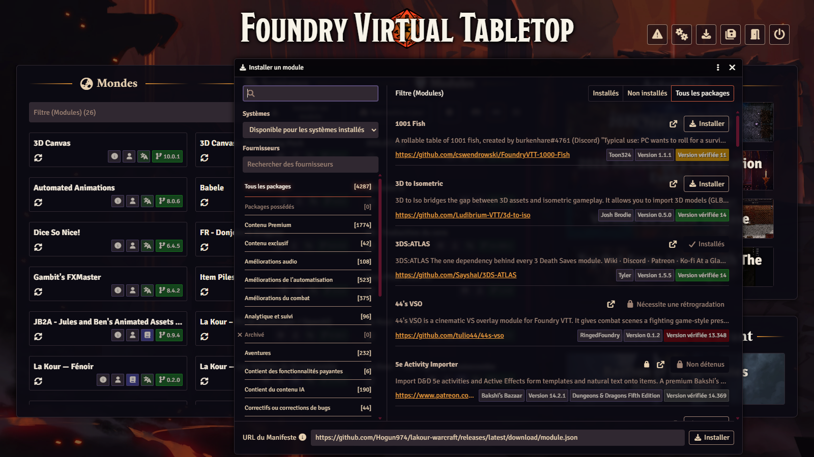
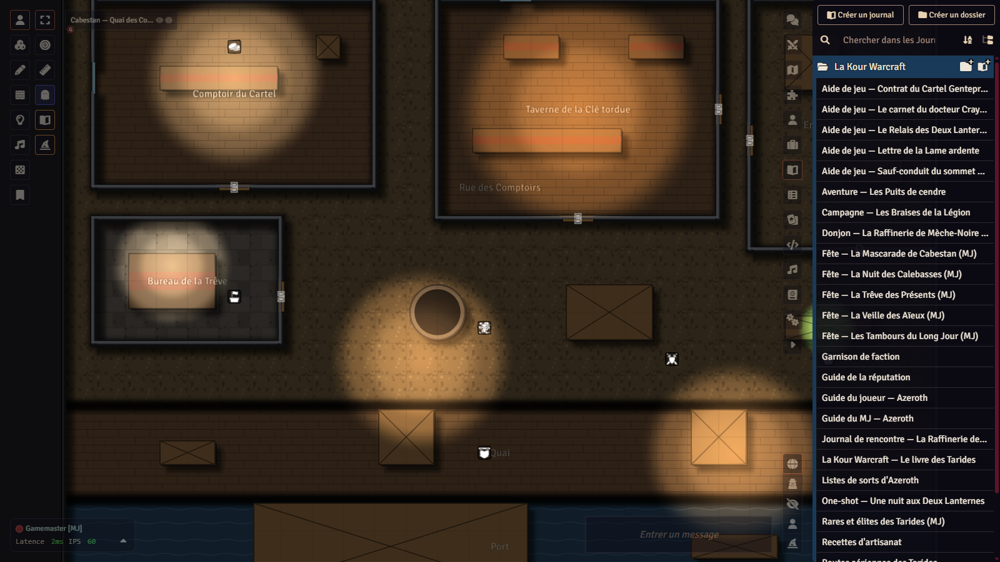
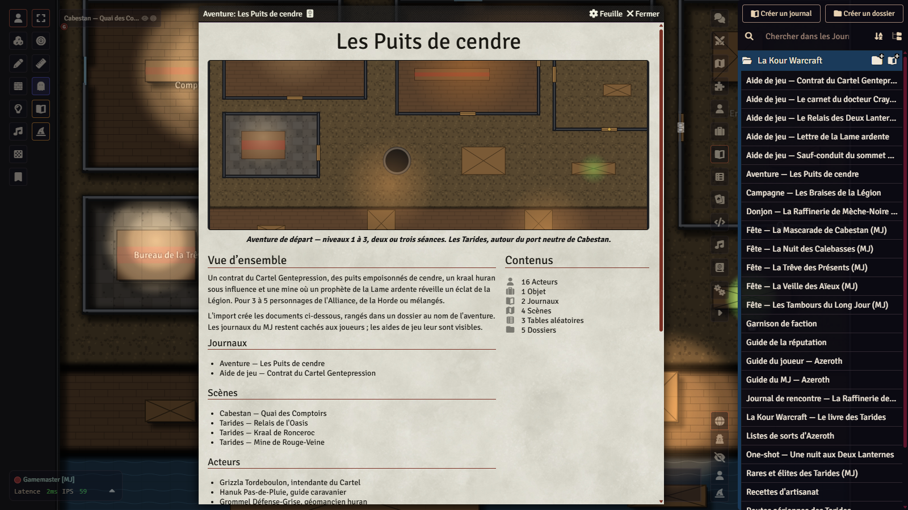
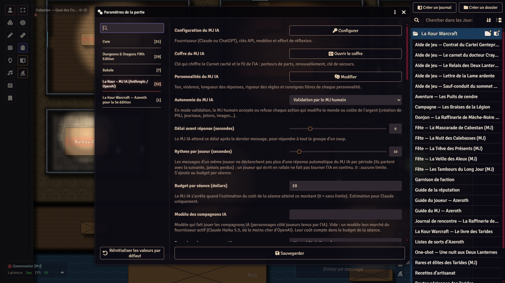

# Tutoriel — La Kour Warcraft, de zéro à la première séance

*[English version](TUTORIAL.md) · [README](README.md)*

Ce tutoriel suppose que vous n'avez jamais installé La Kour Warcraft. À la fin, vous aurez un monde Foundry prêt à jouer,
l'aventure de départ ouverte et, si vous le souhaitez, le meneur de jeu IA configuré avec des réglages prudents.
Comptez une demi-heure, téléchargements compris.

> Les captures d'écran citées ci-dessous (`docs/captures/tuto-…png`) sont prises avec l'interface de Foundry en
> français ; elles peuvent manquer tant qu'elles n'ont pas été ajoutées au dépôt (liste dans
> [`docs/captures/LISEZ-MOI.md`](docs/captures/LISEZ-MOI.md)).

## Sommaire

1. [Ce qu'il faut](#1-ce-quil-faut)
2. [Installer le module](#2-installer-le-module)
3. [Installer le monde vierge](#3-installer-le-monde-vierge)
4. [Version anglaise](#4-version-anglaise)
5. [Premier lancement](#5-premier-lancement)
6. [Ce que contient le module](#6-ce-que-contient-le-module)
7. [Le MJ IA (facultatif)](#7-le-mj-ia-facultatif)
8. [Règles maison automatisées](#8-règles-maison-automatisées)
9. [Votre première séance](#9-votre-première-séance)
10. [Dépannage](#10-dépannage)

## 1. Ce qu'il faut

| Quoi | Version | Remarque |
|---|---|---|
| **Foundry Virtual Tabletop** | **v14** (testé avec la 14.370 ; manifeste vérifié avec la 14.369) | Licence Foundry nécessaire. Le module ne fonctionne pas en v13. |
| **Système `dnd5e`** | **6.0.6** conseillée | Le module accepte la 6.0.0 et plus ; le monde vierge exige **6.0.6 ou plus**. Gratuit, s'installe depuis Foundry (**Systèmes de jeu › Installer un système**, chercher « Dungeons & Dragons Fifth Edition »). |
| **Module `lakour-warcraft`** | dernière version | Le contenu : peuples, sous-classes, objets, bestiaire, aventures, cartes. |
| **Module `lakour-mj-ia`** (La Kour – MJ IA) | 0.40.1 ou plus | **Facultatif** pour le module seul, **requis** par le monde vierge (à installer avant lui, section 3). Fêtes de saison, horloges de réputation, style visuel plat ou relief, et le meneur de jeu IA s'il est configuré. |

**Pour jouer en français** (recommandé, rien n'est obligatoire) :

- **fr-core** : l'interface de Foundry en français (choisir ensuite *Français* dans **Configuration › Langue par défaut**) ;
- **babele** et **dnd5e_fr-FR** : les compendiums du système dnd5e (classes, sorts, dons, équipement du SRD) en
  français, pour que tout ce que le module référence s'affiche dans la même langue que lui.

Le monde vierge français active ces trois modules s'ils sont installés ; il ne les exige pas. Installez-les depuis
**Modules complémentaires › Installer un module** en cherchant leur nom.

**Modules facultatifs** que le monde vierge active s'ils sont présents, et que le MJ IA sait exploiter : Sequencer et
JB2A (animations), Automated Animations, FXMaster (météo), Calendaria (date et météo du jour), Item Piles (butin,
coffres, marchands), Dice So Nice, 3D Canvas (`levels-3d-preview`, vue en relief). Aucun n'est nécessaire.

## 2. Installer le module

Dans l'écran d'accueil de Foundry (celui où l'on choisit un monde) : onglet **Modules complémentaires** ›
**Installer un module**. En bas de la fenêtre, collez dans **URL du manifeste** :

```
https://github.com/Hogun974/lakour-warcraft/releases/latest/download/module.json
```

puis **Installer**. Faites de même pour le moteur du MJ IA (indispensable au monde vierge, facultatif sinon) :

```
https://github.com/Hogun974/lakour-mj-ia/releases/latest/download/module.json
```



Les mises à jour arrivent ensuite par le bouton **Mettre à jour** de l'écran des modules : le manifeste pointe toujours
vers la dernière version publiée.

## 3. Installer le monde vierge

Le monde vierge est un monde Foundry déjà configuré : système dnd5e, module activé, unités métriques, écran d'accueil,
guides et cartes de l'aventure de départ déjà importés, première carte active. Il est publié avec chaque version, à
côté du module, sous forme d'archive : `la-kour-warcraft.zip` (français) et `la-kour-warcraft-en.zip` (anglais).

> **Foundry 14 n'installe plus de monde par son URL de manifeste** : l'onglet **Mondes de jeu** ne propose que
> **Créer un monde**. Deux chemins marchent : décompresser le monde vierge (A) ou créer le vôtre (B).

### Chemin A — le monde vierge prêt à jouer

1. **Installez d'abord ce qu'il exige**, par URL de manifeste : le système **dnd5e** 6.0.6 ou plus
   (**Systèmes de jeu › Installer un système**), puis les modules `lakour-warcraft` et `lakour-mj-ia` (section 2).
2. **Téléchargez** `la-kour-warcraft.zip` dans la dernière version publiée :
   <https://github.com/Hogun974/lakour-warcraft/releases/latest> (rubrique *Assets*).
3. **Trouvez le dossier de données de Foundry** : écran de configuration › onglet **Configuration** › champ
   **Chemin des données** (*User Data Path*). Sur un hébergeur, passez par son gestionnaire de fichiers.
4. **Décompressez** l'archive dans un nouveau dossier `Data/worlds/la-kour-warcraft/` (le nom du dossier est
   l'identifiant du monde) : `world.json` doit se trouver directement dedans, pas dans un sous-dossier.
5. **Redémarrez Foundry** (le serveur ou l'application) : il ne voit un nouveau dossier de monde qu'au démarrage. Le
   monde *La Kour — Les Tarides (Warcraft)* apparaît alors dans **Mondes de jeu**.

### Chemin B — votre propre monde

1. **Mondes de jeu › Créer un monde**, système **Dungeons & Dragons Fifth Edition**.
2. Lancez-le, puis **Réglages › Gérer les modules** : cochez **La Kour Warcraft** (et **La Kour – MJ IA** si vous le
   voulez).
3. Au chargement, le module propose d'**installer le contenu** : acceptez (détails en section 5).

### Sécuriser le monde avant d'inviter qui que ce soit

L'utilisateur **Gamemaster** du monde vierge n'a **pas de mot de passe**. Lancez le monde, connectez-vous en
Gamemaster, puis **Réglages › Configuration › Utilisateurs** (ou depuis l'écran d'accueil du monde) : donnez-lui un
mot de passe. Créez au même endroit un utilisateur par joueur ou joueuse, avec le rôle **Joueur**.

## 4. Version anglaise

Une édition anglaise du contenu, le module **`lakour-warcraft-en`**, est fabriquée à partir des mêmes sources (mêmes
documents, mêmes identifiants ; un texte pas encore traduit reste en français). Elle a son propre monde vierge.

| Quoi | Où le prendre |
|---|---|
| Module anglais | URL du manifeste `https://github.com/Hogun974/lakour-warcraft/releases/latest/download/lakour-warcraft-en.json` |
| Monde vierge anglais | archive `la-kour-warcraft-en.zip` de la [dernière version](https://github.com/Hogun974/lakour-warcraft/releases/latest), à décompresser dans `Data/worlds/la-kour-warcraft-en/` (chemin A de la section 3) |

N'activez **jamais** `lakour-warcraft` et `lakour-warcraft-en` dans le même monde. Le monde anglais désactive les
modules de traduction française (fr-core, dnd5e_fr-FR, babele). Le tutoriel en anglais est [TUTORIAL.md](TUTORIAL.md).

## 5. Premier lancement

1. **Lancez le monde** et entrez en Gamemaster. L'écran d'accueil montre les Tarides au crépuscule (visuel dessiné
   par programme, `assets/monde/fond.jpg`).
2. **Monde vierge** : la carte **Cabestan — Quai des Comptoirs** est déjà active ; les guides, l'aventure de départ,
   la campagne, le one-shot, le donjon et les journaux des fêtes sont rangés dans le dossier **La Kour Warcraft** de
   l'onglet Journaux. Rien d'autre à faire.
3. **Votre propre monde** : à l'ouverture, le module demande s'il doit **installer le contenu**. Acceptez : les guides
   (joueur et MJ), les aventures et leurs cartes sont importés ; peuples, historiques, objets, bestiaire et lieux
   génériques restent dans les compendiums. Le même bouton se trouve dans **Réglages › Configurer les réglages ›
   La Kour Warcraft › Installer** ; le relancer après une mise à jour rafraîchit ce qui a changé sans toucher à vos
   notes. Activez aussi les **unités métriques** du système dnd5e (le module compte en mètres, une case = 1,5 m).



4. **Lisez les guides** : les joueurs lisent le *Guide du joueur — Azeroth* et *Le livre des Tarides* (le livre
   d'univers) ; vous lisez le *Guide du MJ — Azeroth* (caché aux joueurs), puis le journal de l'aventure de départ.
5. **Créez les personnages** : nouvel acteur de type *Personnage*, puis glissez depuis les compendiums un **peuple**,
   un **historique**, une classe du système dnd5e et, au niveau voulu, une **sous-classe** d'Azeroth. Les avancements
   de dnd5e font le reste (traits, maîtrises, sorts toujours préparés). Un jeton par peuple est fourni, en deux styles.

## 6. Ce que contient le module

Douze compendiums, rangés dans le dossier **La Kour Warcraft** de l'onglet Compendiums :

- **Peuples** (13), **Historiques et dons**, **Sous-classes** (13), **Dons et affiliations**, **Sorts**, **Objets**
  (armes, armures, consommables, métiers, garnison), **Afflictions**, **Bestiaire** (70 fiches), **Tables** ;
- **Guides et aventures** : les guides, le livre d'univers, les journaux des aventures et des fêtes, les aides de jeu ;
- **Scènes** : les cartes jouables (murs, portes, lumières, sons, épingles vers le journal) et huit **lieux génériques**
  (auberge, campement orc, crypte, clairière, mine, port, ruines elfiques, village) à sortir quand le récit y mène ;
- **Aventures prêtes à jouer** : chaque aventure en un seul paquet *Adventure*.

| Aventure | Format | Niveaux |
|---|---|---|
| **Les Puits de cendre** | aventure de départ, 4 scènes | 1 → 3 |
| **Les Braises de la Légion** | campagne en 4 chapitres | 3 → 6 |
| **Une nuit aux Deux Lanternes** | one-shot d'enquête | 3 |
| **La Raffinerie de Mèche-Noire** | donjon à trois boss | 5 |
| **Les Tarides vivantes** | supplément de bac à sable (contrats, réputations, montures, rares) | 1 → 6 |

**Importer en un clic** : ouvrez le compendium **Aventures prêtes à jouer**, ouvrez une aventure et cliquez sur
**Importer** ; journaux, cartes, PNJ, objets et tables arrivent dans un dossier à son nom. À la création d'un monde
dnd5e, Foundry propose d'ailleurs *Les Puits de cendre* en démarrage rapide.



## 7. Le MJ IA (facultatif)

Le module **La Kour – MJ IA** (`lakour-mj-ia`) est un compagnon : sans lui, tout le contenu reste utilisable à la main.
Sans clé d'API, il apporte déjà des outils (fêtes de saison, horloges de réputation, tour par tour guidé, carnet de
campagne, style visuel plat ou relief). Avec **votre propre clé** chez un fournisseur de modèles (Claude d'Anthropic ou
ChatGPT d'OpenAI, payée à l'usage chez ce fournisseur), il devient un **meneur de jeu IA** : il raconte dans le chat,
joue les PNJ, pose les jetons, demande les jets, tient les réputations et anime les fêtes, sous le contrôle du MJ humain.

Le monde vierge est livré avec des **réglages prudents** :

| Réglage du MJ IA | Valeur du monde vierge | Pourquoi |
|---|---|---|
| Personnalité active | **Le Conteur épique** | Narration chaleureuse et vivante, fidèle aux règles. |
| Autonomie | **Validation par le MJ humain** | Chaque action qui modifie le monde ou coûte de l'argent attend votre accord. |
| Budget par séance | **10 $** | Le MJ IA s'arrête quand l'estimation du coût de la séance atteint ce montant. |



La clé, le choix du fournisseur, la console (chapeau de magicien dans la barre de gauche), les personnalités, la voix
et la sécurité sont expliqués dans le tutoriel du moteur :
**[TUTORIEL.md de lakour-mj-ia](https://github.com/Hogun974/lakour-mj-ia/blob/principale/TUTORIEL.md)**
([English](https://github.com/Hogun974/lakour-mj-ia/blob/principale/TUTORIAL.md)). Le moteur installe aussi son guide
d'utilisation dans chaque monde (journaux *MJ IA — Guide du MJ* et *MJ IA — Guide des joueurs*).

Deux précautions : fixez un **plafond de dépense** sur la clé chez le fournisseur (le budget du module n'est qu'une
estimation), et ne menez pas le MJ IA depuis un poste partagé (la clé est gardée dans le navigateur du MJ).

## 8. Règles maison automatisées

Le module applique ses règles d'Azeroth dans Foundry quand c'est possible ; seul le **MJ connecté** écrit dans le
monde, et un automatisme qui ne peut pas fonctionner s'éteint sans rien casser.

- **Auras** (Aura de pureté, Aura de froid) : l'effet suit les alliés dans le rayon, à chaque déplacement.
- **Familier du chasseur** : « Lier le familier », puis ses points de vie, sa CA et ses dégâts suivent le rôdeur.
- **Totems élémentaires** du chaman : le gabarit posé est le totem, les alliés à 3 m reçoivent son effet.
- **Chevalier de la mort** : Poigne de la mort attire la cible, Armée des morts pose et renvoie les goules.
- **Châtiment du Fléau**, **Champion de la Lumière**, **Avatar des éléments**, **Évasion d'agent**, **Fût roulant**,
  **Ivresse du sage** : ciblage, lumière, recharge et réactions gérés.
- **Fureur** (une fois par combat), **ensembles** d'objets, **phase 2 des boss** (rappel au MJ à 50 % des PV).
- **Établi d'artisanat** (bouton dans l'en-tête de la fiche), **réputations** (une horloge par faction, avec le MJ IA),
  **garnison de faction** (activez le réglage *Bastions* de dnd5e).

Le détail est dans le [README](README.md#règles-maison-et-automatisations).

## 9. Votre première séance

- [ ] Mot de passe du Gamemaster posé, un utilisateur par joueur créé.
- [ ] Personnages créés (peuple, historique, classe) et leurs jetons posés sur **Cabestan — Quai des Comptoirs**.
- [ ] Journal **Les Puits de cendre** lu (synopsis, scène 1, indices) ; aides de jeu prêtes à montrer
      (clic droit › *Montrer aux joueurs*).
- [ ] Unités métriques actives (réglages du système dnd5e).
- [ ] Facultatif : MJ IA configuré (clé, personnalité, mode validation) et testé avec une courte narration.
- [ ] Lancez la séance : la Trêve de Cabestan, les puits qui se gâtent, et le Cartel qui paie pour savoir pourquoi.

## 10. Dépannage

| Symptôme | Cause probable | Que faire |
|---|---|---|
| Le monde refuse de se lancer, « système incompatible » | dnd5e plus ancien que 6.0.6 | Mettez à jour le système dnd5e (**Systèmes de jeu › Mettre à jour**). |
| Le monde vierge n'apparaît pas dans **Mondes de jeu** | Foundry pas redémarré, ou archive décompressée au mauvais endroit | Vérifiez que `Data/worlds/la-kour-warcraft/world.json` existe (pas de sous-dossier en trop), puis redémarrez Foundry. |
| Foundry signale des modules manquants au lancement du monde | dépendances non installées | Installez dnd5e, `lakour-warcraft` et `lakour-mj-ia` par leur URL de manifeste (section 2), puis relancez. |
| Le module n'apparaît pas dans **Gérer les modules** | Foundry v13 ou plus ancien | Le module exige Foundry v14. |
| Les journaux ou cartes manquent dans votre monde | contenu pas encore installé | **Réglages › Configurer les réglages › La Kour Warcraft › Installer**. |
| Les classes et sorts du SRD restent en anglais | traduction du système absente | Installez et activez **babele**, **dnd5e_fr-FR** et **fr-core**. |
| Des distances s'affichent en pieds | unités impériales du système | Activez les unités métriques dans les réglages de dnd5e. |
| Textes en double, ou mélange de français et d'anglais | `lakour-warcraft` et `lakour-warcraft-en` actifs ensemble | N'en gardez qu'un. |
| Pas de barre d'outils ni de console du MJ IA | aucune scène active | Activez une scène (clic droit sur la carte › *Activer*). |
| Une aura, un totem ou un familier ne réagit pas | aucun MJ connecté, ou automatisme désactivé faute d'API | Un MJ doit être connecté ; relisez le texte de la capacité, qui dit ce qui reste à la main. |
| Le MJ IA ne répond pas | pas de clé, budget atteint, ou mode validation en attente | Voir la console du MJ IA et le [tutoriel du moteur](https://github.com/Hogun974/lakour-mj-ia/blob/principale/TUTORIEL.md). |
| Les illustrations des fêtes ou le fond d'accueil manquent | module ancien ou installation incomplète | Mettez à jour le module (les visuels sont dans `assets/`). |

Un autre souci ? Ouvrez une [issue](https://github.com/Hogun974/lakour-warcraft/issues) avec les versions de Foundry,
de dnd5e et du module, et ce que vous attendiez.

---

*La Kour Warcraft est une œuvre de fan non officielle, non affiliée à Blizzard Entertainment. Code et textes écrits
avec l'aide d'une IA (Claude, d'Anthropic), relus par l'auteur ; visuels produits par programme. Licences :
[README](README.md#licence).*
